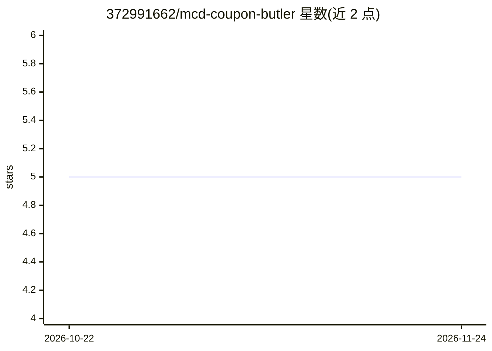

# 372991662/mcd-coupon-butler

⭐ — · [GitHub]() · 个人维护 · 中文 README

**麦当劳会员券/积分/活动资产的一句话管理管家**

通过麦当劳中国官方 MCP 服务（mcp.mcd.cn）收拢散落在 App 内的优惠券、积分、抽奖机会、商城兑换、营销活动与 24 节气徽章信息，以 MCP 连接器 + SKILL.md 技能形式接入 WorkBuddy/Cursor 等客户端，用自然语言完成一键领券、临期预警、积分体检与最优兑换试算、抽奖、活动雷达和节气窗口推算；消耗积分或支付的操作在代码层拦截，需显式确认才执行。另提供不依赖客户端的 Python 命令行脚本。为麦当劳程序员创意开发大赛参赛作品，非官方产品。

## 筛选速览

| 维度 | 判定 | 备注 |
|---|---|---|
| AI 角色 | `ai-native` | 本体是模型或模型工具 |
| 许可风险 | `permissive` | — |
| 部署形态 | `None` |  |
| 模型依赖 | — | README 未给出锁定关系 |
| 硬件要求 | — | 无带数字的原话,不猜 |
| 安装摩擦 | `low` | 无编译、无系统依赖或容器化 |
| 成熟度 | — | 结构信号不足 |

## 能力要点

- 一键领走麦麦省全部可领券，券包按到期时间排序并置顶临期券
- 积分按「每积分价值」排序给出最优兑换建议
- 消耗积分/支付的操作代码层拦截，需显式 --confirm 放行
- 24 节气徽章窗口本地离线推算，经官方 10 期窗口校验

## 适用场景

- 每周吃麦当劳时一句话领券并查看哪些券快过期
- 积分快过期时让管家算换什么最值
- 设为定时任务每周自动检查上新与联名活动
- 集齐全年 24 节气徽章不漏领

## 场景标签

`AI 助手` · 领域:对话与助手

## 证据(README 行号)

> L61: 把下面的 JSON 填进你的 MCP 客户端（WorkBuddy / Cursor / Cherry Studio / Trae 等），
> L83: 把本仓库的 `SKILL.md` 放进你的技能目录即可。然后在对话框里直接说人话：

## 星数曲线

2026-10-22 5 → 2026-11-24 5（+0）

---
*卡片 v1 · prompt 1.4 · 生成 2026-11-21 · 置信度 high · 依据 README sha `cdd6ee676640` · [字段定义](../../DATASET.md)*
