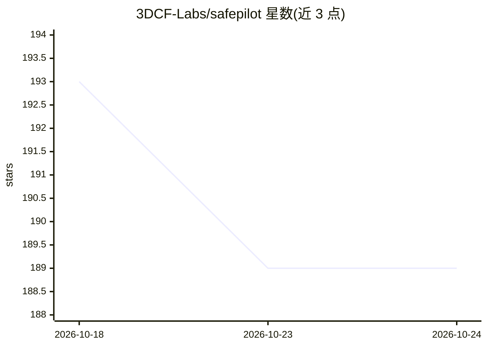

# 3DCF-Labs/safepilot

⭐ 189 · Rust · Apache-2.0 · 推送 2026-03-06 · [GitHub](https://github.com/3DCF-Labs/safepilot) · [官网](https://safepilot.dev/) · 组织维护

**自托管 Telegram AI 助手：把消息转为带审批检查点的自动化任务执行**

Rust 实现的自托管个人 AI 助手，通过 Telegram 界面交互。消息生成持久化于 SQLite 的 Run（任务 DAG），安全任务自动排队执行，风险任务在检查点阻断等待审批（内联按钮或自然语言批准）。支持 direct 与 agent 两种 LLM 模式，默认走 Anthropic/OpenAI HTTP API。安全机制包括 shell 白名单、SSRF 防护、子进程清空环境变量、敏感字段静态加密及可选 bubblewrap 沙箱。集成 Slack/GitHub/Notion/Linear/Jira 等。需 Rust 工具链编译或 Docker Compose 部署。

## 筛选速览

| 维度 | 判定 | 备注 |
|---|---|---|
| AI 角色 | `ai-native` | 本体是模型或模型工具 |
| 许可风险 | `permissive` | Apache-2.0 |
| 部署形态 | `self-host` | docker 或自建部署 |
| 模型依赖 | locked-api |  |
| 硬件要求 | — | 无带数字的原话,不猜 |
| 安装摩擦 | `low` | 无编译、无系统依赖或容器化 |
| 成熟度 | — | 结构信号不足 |

## 能力要点

- 消息→Run→任务 DAG→Job 的持久化执行模型（SQLite）
- safe/needs_approval/dangerous 三级策略分类与审批检查点
- SSRF 防护、子进程清空环境、敏感字段静态加密、可选 bubblewrap 沙箱
- direct/agent 双 LLM 模式，支持 Anthropic 与 OpenAI API

## 适用场景

- 通过 Telegram 让 AI 助手执行日常自动化任务并审批风险操作
- 自托管掌控数据的个人 AI 助理，接入 GitHub/Slack/Notion 等服务
- 在受控策略下运行需要 shell 与网络访问的 agent 任务

## 场景标签

`AI 助手` `工作流自动化` · 领域:效率与自动化

## 证据(README 行号)

> L10: **SafePilot** - a self-hosted AI assistant that executes real work, safely. It turns messages into executable autom
> L22:  - `LLM_MODE=direct`: uses Anthropic/OpenAI HTTP APIs to produce `{reply, actions}`.
> L23:  - `LLM_MODE=agent`: iterative tool-calling loop with per-run checkpoints. Safe tool calls execute inline; risky to

## 星数曲线

2026-10-18 193 → 2026-10-24 189（-4）

---
*卡片 v1 · prompt 1.4 · 生成 2026-10-22 · 置信度 high · 依据 README sha `74d5f047276f` · [字段定义](../../DATASET.md)*
