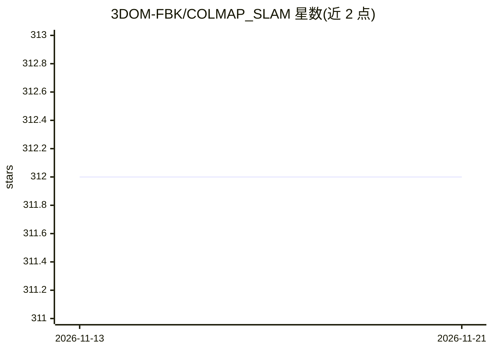

# 3DOM-FBK/COLMAP_SLAM

⭐ 312 · Python · 推送 2026-11-10 · [GitHub](https://github.com/3DOM-FBK/COLMAP_SLAM) · 组织维护

**基于深度学习与 COLMAP 的视觉 SLAM/里程计框架**

面向自动驾驶与三维视觉开发/科研人员的视觉里程计框架：以 colmap-odometry 作为子模块（锁定特定 commit），处理多相机图像序列输出每帧相机位姿（COLMAP 格式 trajectory.txt），支持 --gui 实时轨迹绘制；可选传入 GNSS 文件，用 gtsam 位姿图对里程计结果做优化融合。安装经 uv 建虚拟环境后 pip 可编辑安装，GPU 支持需自行安装 PyTorch；随附 CARLA 示例数据。附两篇参考论文（含 2025 年 Deep Learning in Visual Odometry）。

## 筛选速览

| 维度 | 判定 | 备注 |
|---|---|---|
| AI 角色 | `ai-native` | 本体是模型或模型工具 |
| 许可风险 | `none` | — |
| 部署形态 | `library` | 以包/库形式分发 |
| 模型依赖 | — | README 未给出锁定关系 |
| 硬件要求 | — | 无带数字的原话,不猜 |
| 安装摩擦 | `low` | 无编译、无系统依赖或容器化 |
| 成熟度 | — | 结构信号不足 |

## 能力要点

- 多相机图像序列输出逐帧相机位姿（camera-to-world，含协方差）
- GNSS 位姿图优化（gtsam），可配置 GNSS/里程计不确定度
- colmap-odometry 子模块锁定固定 commit 保证兼容性
- 随附 CARLA 示例数据与实时轨迹 GUI

## 适用场景

- 在 CARLA 或自采多相机数据上运行视觉里程计估计轨迹
- 融合 GNSS 观测对里程计轨迹做优化
- 自动驾驶/测绘场景的相机位姿估计研究

## 场景标签

`科研工具` · 领域:学习与行业

## 证据(README 行号)

> L57: Run colmap-odometry on the sample CARLA dataset in `assets/`:
> L60: python cslam.py

## 星数曲线

2026-11-13 312 → 2026-11-21 312（+0）

---
*卡片 v1 · prompt 1.4 · 生成 2026-11-17 · 置信度 high · 依据 README sha `b681c14a5802` · [字段定义](../../DATASET.md)*
