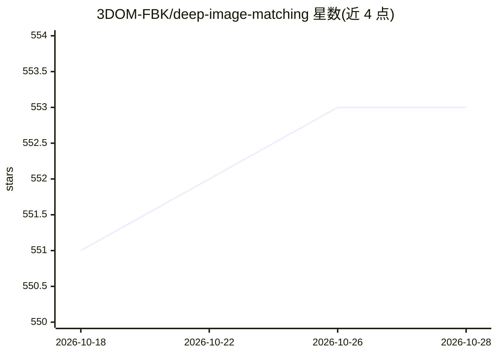

# 3DOM-FBK/deep-image-matching

⭐ 554 · Python · NOASSERTION · 推送 2026-02-19 · [GitHub](https://github.com/3DOM-FBK/deep-image-matching) · [官网](https://3dom-fbk.github.io/deep-image-matching/) · 组织维护

**面向 SfM 软件的多视图图像匹配工具箱（深度学习+手工特征）**

为 COLMAP、OpenMVG、MicMac、Agisoft Metashape 等运动恢复结构软件提供特征提取与匹配的工具箱：支持 14 种特征提取器（SIFT、SuperPoint、DISK、ALIKED 等）与 7 种匹配器（LightGlue、SuperGlue、LoFTR、RoMa 等），可导出关键点与匹配结果至 COLMAP 数据库或 Bundler 格式；支持大幅面图像、图像旋转、图像检索与图聚类，并可直接运行 SfM（pycolmap 等）。提供 CLI 与 GUI，亦可作为 Python 库使用；项目自述仍处实验性活跃开发阶段。

## 筛选速览

| 维度 | 判定 | 备注 |
|---|---|---|
| AI 角色 | `ai-native` | 本体是模型或模型工具 |
| 许可风险 | `none` | NOASSERTION |
| 部署形态 | `library` | 以包/库形式分发 |
| 模型依赖 | — | README 未给出锁定关系 |
| 硬件要求 | — | 无带数字的原话,不猜 |
| 安装摩擦 | `low` | 无编译、无系统依赖或容器化 |
| 成熟度 | `idea` | |

## 能力要点

- 14 种特征提取器与 7 种匹配器（含 OpenCV 手工特征与 KORNIA 深度学习特征）
- 关键点与匹配结果直接导出 COLMAP 数据库或 Bundler 格式供 Metashape 使用
- 支持大幅面图像、旋转图像、深度学习特征图像检索与图聚类
- 可在工具内直接运行 SfM（pycolmap、openmvg 等），支持 CLI 与 GUI

## 适用场景

- 为摄影测量/三维重建流程生成 COLMAP 关键点与匹配数据
- 处理大幅面或带旋转的航拍、历史图像的匹配
- 在 Metashape 中导入 DIM 提取的二维观测做重建

## 场景标签

 · 领域:摄影测量/计算机视觉

## 证据(README 行号)

> L15: Multivew matcher for SfM software. Support both deep-learning based and hand-crafted local features and matchers an
> L25: - SOTA deep-learning and hand-crafted features

## 星数曲线

2026-10-18 551 → 2026-10-28 553（+2）

---
*卡片 v1 · prompt 1.4 · 生成 2026-10-21 · 置信度 mid · 依据 README sha `1fd85cc53999` · [字段定义](../../DATASET.md)*
