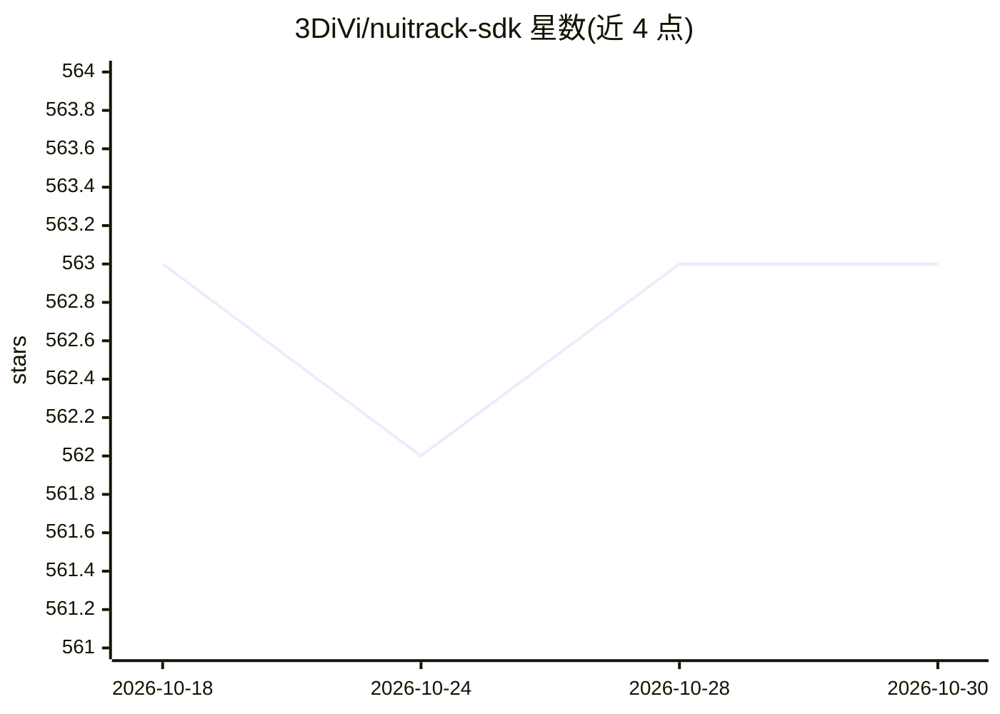

# 3DiVi/nuitrack-sdk

⭐ 563 · C++ · 推送 2026-08-09 · [GitHub](https://github.com/3DiVi/nuitrack-sdk) · [官网](https://nuitrack.com) · 组织维护

**面向深度相机的 3D 骨骼/人体追踪 SDK，供开发者做动作应用**

3DiVi 公司开发的 3D 人体/骨骼追踪中间件，读取深度传感器（Orbbec、Kinect、RealSense 等）数据，输出深度图、3D 点云、地板平面、人员分割与逐人骨骼追踪，并含面部年龄/情绪检测、手部追踪与手势识别 API。提供两套骨骼引擎：面向嵌入式优化的经典引擎与深度学习引擎。支持 C++/C#/Python、Unity、UE5、TouchDesigner 与 Docker，覆盖 Windows/Linux/Android/iOS 及 x86/ARM 平台。商用需在其官网购买许可。

## 筛选速览

| 维度 | 判定 | 备注 |
|---|---|---|
| AI 角色 | `ai-native` | 本体是模型或模型工具 |
| 许可风险 | `none` | — |
| 部署形态 | `None` |  |
| 模型依赖 | — | README 未给出锁定关系 |
| 硬件要求 | — | 无带数字的原话,不猜 |
| 安装摩擦 | `low` | 无编译、无系统依赖或容器化 |
| 成熟度 | — | 结构信号不足 |

## 能力要点

- 逐人 3D 骨骼追踪（经典与深度学习双引擎）
- 深度图/点云、地板平面检测、人员像素级分割
- 手部追踪与手势识别、面部年龄/情绪检测高层 API
- 多语言/引擎绑定：C++/C#/Python、Unity、UE5、TouchDesigner、Docker

## 适用场景

- 健身/舞蹈训练与医疗康复中的动作追踪
- AR/VR 全身追踪与手势自然交互界面
- 机器人视觉与人机共享空间感知
- 观众分析等多传感器分析系统

## 场景标签

`目标检测` · 领域:感知与多模态

## 证据(README 行号)

> L18: **Nuitrack™** is the 3D body / skeletal tracking library for 3D / depth sensors developed by **3DiVi Inc**.
> L38: |**Highly-sophisticated _3D Skeletal Tracking_ for each person**|**Basic _Facial Analysis_ like age and emotion det
> L43:  - AI - deep-learning based engine, which provides greater coverage for complex poses

## 星数曲线

2026-10-18 563 → 2026-10-30 563（+0）

---
*卡片 v1 · prompt 1.4 · 生成 2026-10-21 · 置信度 high · 依据 README sha `b0e8b99f8379` · [字段定义](../../DATASET.md)*
