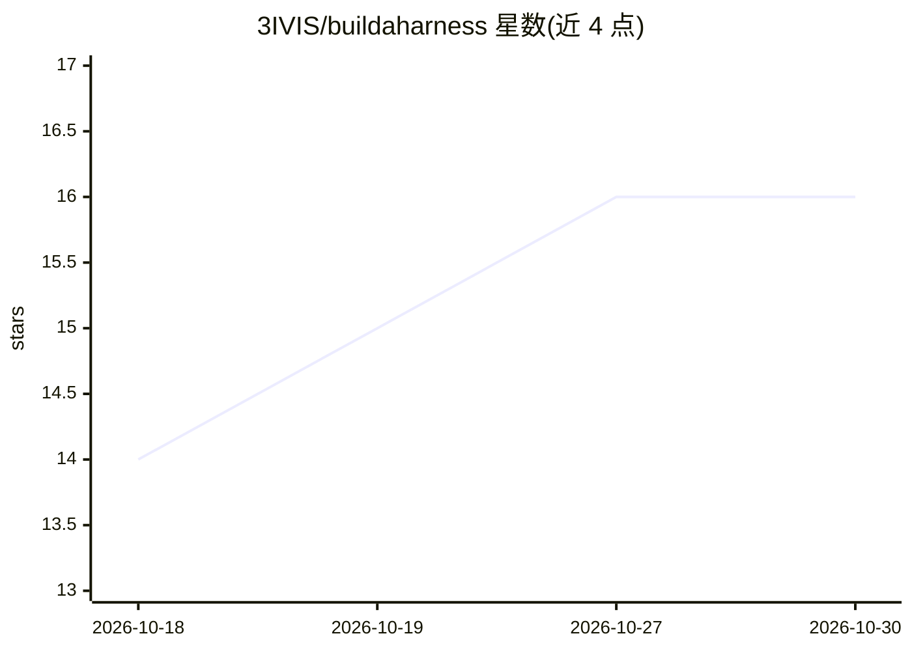

# 3IVIS/buildaharness

⭐ 16 · TypeScript · NOASSERTION · 推送 2026-10-28 · [GitHub](https://github.com/3IVIS/buildaharness) · [官网](https://buildaharness.com) · 个人维护 · 中文 README

**开源 11 层 agent 治理控制层与可视化画布，及参考助手 Aielia**

Build A Harness 是围绕自主 agent 的治理与可靠性控制平面：提供可视化画布编辑 27 种节点（11 层架构）的 FlowSpec JSON，并可编译到 LangGraph / CrewAI / Mastra / MS Agent Framework 四种运行时，经 Langfuse 追踪决策。Aielia 是基于该 harness 的日常 AI 助手参考应用，可执行多步任务，不可逆操作需审批，支持 CLI、浏览器与桌面三种前端。部署全栈需 Docker Compose 启动 11 个服务，或以 npm/脚本方式本地运行，Apache 2.0 许可。

## 筛选速览

| 维度 | 判定 | 备注 |
|---|---|---|
| AI 角色 | `ai-ecosystem` | LLM/agent 周边工具 |
| 许可风险 | `none` | NOASSERTION |
| 部署形态 | `self-host` | docker 或自建部署 |
| 模型依赖 | local-ok | 支持本地模型 |
| 硬件要求 | — | 无带数字的原话,不猜 |
| 安装摩擦 | `low` | 无编译、无系统依赖或容器化 |
| 成熟度 | — | 结构信号不足 |

## 能力要点

- 可视化画布 + FlowSpec 编译到 4 种 agent 框架（LangGraph/CrewAI/Mastra/MS Agent Framework）
- 11 层 harness：控制状态门控、9 层验证、恢复策略、经验存储等
- Aielia 助手：不可逆操作暂存审批、故障安全分类、中断恢复
- Langfuse 可观测性 + LiteLLM 统一路由，支持 Ollama 本地模型

## 适用场景

- 为自主 agent 构建权限与验证的控制层
- 把同一 FlowSpec 部署到不同 agent 框架并追踪决策
- 用 Aielia 交代多步实际工作并在审批门控下执行

## 场景标签

`Agent 框架` `AI 助手` · 领域:Agent 开发

## 证据(README 行号)

> L20: decides whether the result is accepted. **Build A Harness** is an open-source
> L21: visual canvas and runtime for that layer — draw the 11 layers, compile the same
> L22: FlowSpec to LangGraph / CrewAI / Mastra / MS Agent Framework, and trace every

## 星数曲线

2026-10-18 14 → 2026-10-30 16（+2）

---
*卡片 v1 · prompt 1.4 · 生成 2026-10-30 · 置信度 high · 依据 README sha `8e656c72effb` · [字段定义](../../DATASET.md)*
