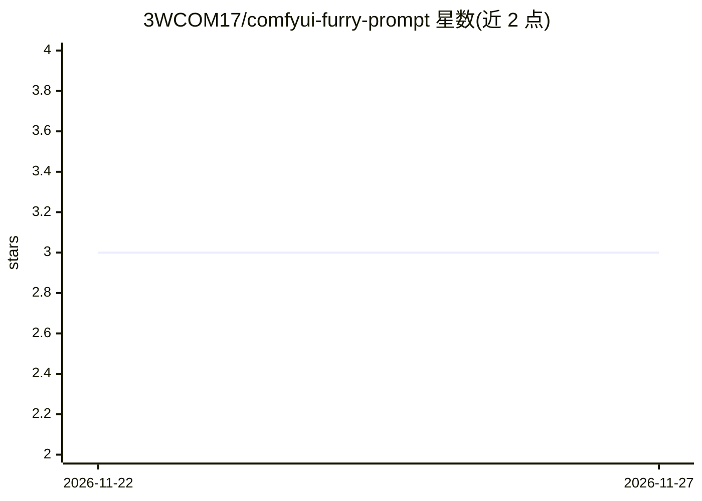

# 3WCOM17/comfyui-furry-prompt

⭐ 3 · JavaScript · NOASSERTION · 推送 2026-11-01 · [GitHub](https://github.com/3WCOM17/comfyui-furry-prompt) · 个人维护 · 中文 README

**ComfyUI 本地 Furry 提示词侧边面板插件**

面向 ComfyUI 的本地插件，把参考图识图（WD14）、e621 标签导入、中英对照词典、自选搭配与 WD14 参数写回整合在一个右侧面板中，不占用画布节点；识图与翻译在本机运行，本地翻译模型（opus-mt、m2m100、qwen2.5）为可选项，缺模型时词典与标签功能仍可用；e621 完整词库与模型权重不随仓库分发，需用户自行准备；当前为 alpha 版本，接口和界面可能变化。

## 筛选速览

| 维度 | 判定 | 备注 |
|---|---|---|
| AI 角色 | `ai-native` | 本体是模型或模型工具 |
| 许可风险 | `none` | NOASSERTION |
| 部署形态 | `library` | 以包/库形式分发 |
| 模型依赖 | — | README 未给出锁定关系 |
| 硬件要求 | — | 无带数字的原话,不猜 |
| 安装摩擦 | `low` | 无编译、无系统依赖或容器化 |
| 成熟度 | `idea` | |

## 能力要点

- 参考图识图、e621 导入、词典、搭配与 WD14 参数写回在同一侧边面板
- 本地翻译模型可选，缺模型时基础功能仍可用
- 不上传图片到第三方、不含遥测，默认只监听本机
- e621 词库格式开放，用户可自备 JSON 文件

## 适用场景

- 在 ComfyUI 中为中英对照的 Furry 提示词做检索与组合
- 用 WD14 识图从参考图提取提示词与参数写回工作流
- 配合 Edge 扩展从 e621 页面导入标签到本地工作流

## 场景标签

`提示工程` `图像生成` · 领域:Agent 开发

## 证据(README 行号)

> L3: 本地 Furry 提示词工作流插件，面向 ComfyUI。
> L5: 它把 **参考图识图、e621 标签导入、中英对照、词典、自选搭配和 WD14 参数写回** 放在同一个侧边面板里，所有处理都在本机完成。
> L21: - WD14 识图：

## 星数曲线

2026-11-22 3 → 2026-11-27 3（+0）

---
*卡片 v1 · prompt 1.4 · 生成 2026-11-22 · 置信度 high · 依据 README sha `5455fad347fc` · [字段定义](../../DATASET.md)*
