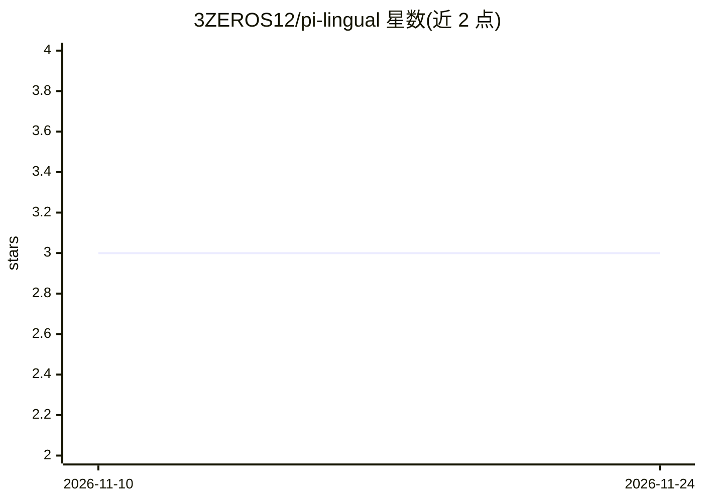

# 3ZEROS12/pi-lingual

⭐ 3 · TypeScript · MIT · 推送 2026-11-14 · [GitHub](https://github.com/3ZEROS12/pi-lingual) · [官网](https://www.npmjs.com/package/pi-lingual) · 个人维护 · 中文 README

**Pi Coding Agent 的双语终端 HUD：母语提示实时翻译与词汇卡**

面向 Pi Coding Agent 的 TypeScript 扩展，在提示词上方渲染双语卡片：口语体（Silicon Valley 日常表达）、书面体（正式技术文风）与工程搭配词三栏，另有双击查词。支持三种模式：companion 直通展示翻译（0ms）、direct/live-flow 在 Enter 时将母语指令改写为技术英语再传给 agent。翻译走当前会话模型的凭证，无需额外 API key；默认查词用 Google 词典，可切换模型通道。通过 `pi install npm:pi-lingual` 安装。

## 筛选速览

| 维度 | 判定 | 备注 |
|---|---|---|
| AI 角色 | `ai-native` | 本体是模型或模型工具 |
| 许可风险 | `permissive` | MIT |
| 部署形态 | `None` |  |
| 模型依赖 | — | README 未给出锁定关系 |
| 硬件要求 | — | 无带数字的原话,不猜 |
| 安装摩擦 | `low` | 无编译、无系统依赖或容器化 |
| 成熟度 | — | 结构信号不足 |

## 能力要点

- companion 模式 0ms 直通渲染双语卡片，不注入翻译 token 到会话历史
- direct/live-flow 模式在 Enter 时将母语提示改写为技术英语，代码块保持不翻译
- 4 个预设 loadout：工程规格化、Conventional Commits、GitHub 评论、开发者帖子改写
- 基于 Unicode UAX #11 的开放左轨布局，适配 CJK 全角字符与 tmux/WezTerm 分屏

## 适用场景

- 用中文/日文写提示，同时让提交的代码注释与 commit 保持纯英文
- 利用 LLM 生成的 5-15 秒间隙学习工程口语与书面表达
- 将口语化描述一键改写为符合规范的 commit 信息或 PR 评论

## 场景标签

`编码 Agent` `提示工程` · 领域:Agent 开发

## 证据(README 行号)

> L3: A bilingual terminal HUD and prompt transformer for Pi Coding Agent.
> L5: Code in your native language. See real-time Silicon Valley spoken phrasing and formal technical prose—or transform p
> L39: > ⚡ **Latency Profile**: In factory default Companion mode, prompt delivery is 0ms (pass-through directly to the co

## 星数曲线

2026-11-10 3 → 2026-11-24 3（+0）

---
*卡片 v1 · prompt 1.4 · 生成 2026-11-22 · 置信度 high · 依据 README sha `07386746f2df` · [字段定义](../../DATASET.md)*
