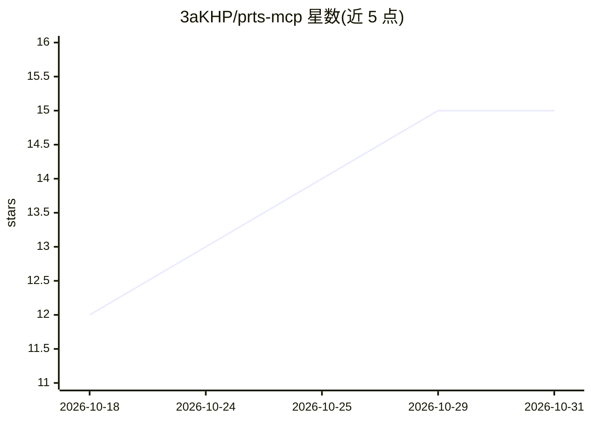

# 3aKHP/prts-mcp

⭐ 15 · Rust · MIT · 推送 2026-10-30 · [GitHub](https://github.com/3aKHP/prts-mcp) · 个人维护 · 中文 README

**向 AI agent 提供明日方舟 Wiki 与游戏数据的 MCP 服务器**

面向明日方舟同人创作 AI agent 的 MCP Server：通过 PRTS Wiki MediaWiki API 与自动同步的干员游戏数据表，向 Claude Desktop、Claude Code、Chatbox 等 MCP 客户端提供 24 个工具，覆盖 Wiki 检索、干员档案/语音/立绘、剧情全文与摘要、敌人/关卡/物品数据的正则全文检索。3.x 起为 Rust 单体实现，预编译二进制、npm 包与 Docker 镜像均内置只读数据快照，支持离线查询；数据每小时后台自动同步，经 manifest SHA-256 校验后切换。

## 筛选速览

| 维度 | 判定 | 备注 |
|---|---|---|
| AI 角色 | `ai-ecosystem` | LLM/agent 周边工具 |
| 许可风险 | `permissive` | MIT |
| 部署形态 | `desktop` | 安装包/桌面程序 |
| 模型依赖 | — | README 未给出锁定关系 |
| 硬件要求 | — | 无带数字的原话,不猜 |
| 安装摩擦 | `low` | 无编译、无系统依赖或容器化 |
| 成熟度 | — | 结构信号不足 |

## 能力要点

- 24 个 MCP 工具：Wiki 检索、干员档案/语音/属性、剧情对话与 LLM 摘要、敌人/关卡/物品正则全文检索
- Rust 原生实现，预编译二进制/Docker/npm 三种分发，含校验的只读数据快照可离线查询
- 数据通过自建 pipeline 每小时自动同步，manifest SHA-256 验证失败时旧数据不中断
- 支持 HTTP 与 stdio 两种传输，输出可选 content/structured 双通道

## 适用场景

- 让 Claude 等 MCP 客户端在写同人或查设定时直接读取方舟剧情与干员资料
- 对剧情台词、干员数据做正则全文检索与角色出场统计
- 在服务器上以 Docker 部署，供多个 agent 客户端共享数据服务

## 场景标签

`网页抓取` · 领域:效率与自动化

## 证据(README 行号)

> L12: An MCP Server for Arknights fan creation (同人創作) AI agents. Powered by the PRTS Wiki MediaWiki API and auto-synced o
> L66: For MCP client configuration snippets (`Claude Desktop`, `Claude Code`, `Roo Code`, `Codex`), see the Agent & MCP B

## 星数曲线

2026-10-18 12 → 2026-10-31 15（+3）

---
*卡片 v1 · prompt 1.4 · 生成 2026-10-31 · 置信度 mid · 依据 README sha `de1844d6615f` · [字段定义](../../DATASET.md)*
