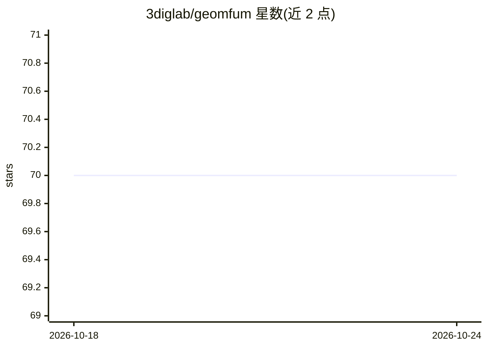

# 3diglab/geomfum

⭐ 70 · Python · MIT · 推送 2026-06-26 · [GitHub](https://github.com/3diglab/geomfum) · [官网](https://3diglab.github.io/geomfum.github.io/index.html) · 组织维护

**面向科研的函数映射几何处理与机器学习 Python 库**

基于函数映射（Functional Maps）的模块化几何处理与机器学习 Python 库，用于网格、点云的形状匹配与形状对应等任务。实现 14 篇论文方法（ZoomOut、Rematching、DiffusionNet、PointNet 等），支持 numpy 与 pytorch 双后端（经 Geomstats 后端 gsops 切换，可视化仅限 numpy 后端）。通过 pip 安装；C++ 依赖（robust_laplacian）可能引发安装问题，pyRMT 需按其说明单独处理。提供 how-to notebook 教程，欢迎社区贡献，有 Discord 社区。

## 筛选速览

| 维度 | 判定 | 备注 |
|---|---|---|
| AI 角色 | `ai-native` | 本体是模型或模型工具 |
| 许可风险 | `permissive` | MIT |
| 部署形态 | `library` | 以包/库形式分发 |
| 模型依赖 | — | README 未给出锁定关系 |
| 硬件要求 | — | 无带数字的原话,不猜 |
| 安装摩擦 | `low` | 无编译、无系统依赖或容器化 |
| 成熟度 | — | 结构信号不足 |

## 能力要点

- 实现 14 篇几何处理与形状匹配论文方法
- numpy/pytorch 双后端切换（GEOMSTATS_BACKEND 环境变量）
- 覆盖网格与点云的形状对应、谱上采样、特征描述子等
- 提供 how-to notebook 入门教程

## 适用场景

- 科研中进行 3D 形状匹配与形状对应实验
- 复现函数映射相关论文方法
- 网格与点云的几何特征计算与分析

## 场景标签

`科研工具` · 领域:学习与行业

## 证据(README 行号)

> L4: **GeomFuM** is a Modular Python Package for Machine Learning with `Functional Maps <https://dl.acm.org/doi/10.1145/2
> L70: List of Implemented Papers

## 星数曲线

2026-10-18 70 → 2026-10-24 70（+0）

---
*卡片 v1 · prompt 1.4 · 生成 2026-10-24 · 置信度 high · 依据 README sha `f8af659978db` · [字段定义](../../DATASET.md)*
