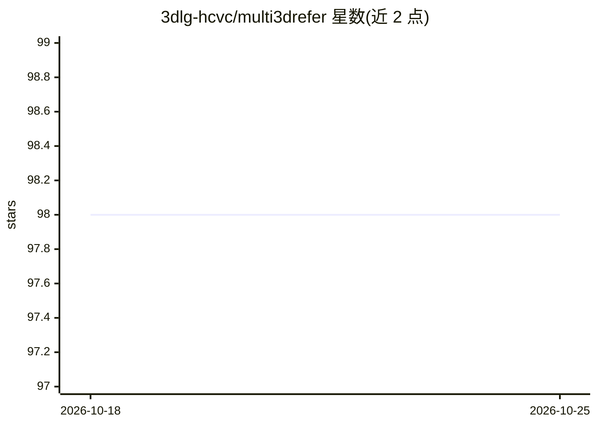

# 3dlg-hcvc/multi3drefer

⭐ 98 · Python · MIT · 推送 2026-03-26 · [GitHub](https://github.com/3dlg-hcvc/multi3drefer) · [官网](https://3dlg-hcvc.github.io/multi3drefer/) · 组织维护

**3D 视觉定位研究代码：文本描述定位多个 3D 物体**

ICCV 2023 论文 Multi3DRefer 的官方 PyTorch 实现（M3DRef-CLIP）：将自然语言描述定位到 3D 场景中零个、一个或多个物体。基于 ScanNet v2 场景数据，使用 MINSU3D/PointGroup 预训练检测器，输入含坐标、颜色与 ENet 多视角特征；支持 ScanRefer、Nr3D、Multi3DRefer 三个数据集的训练、推理与评测，并发布三个对应 checkpoint。仓库含 CUDA 实现，要求 GPU 计算能力 3.0 以上，训练/推理显存峰值分别为 15.2/11.3 GB（batch size 4），通过 Conda 或 Pip（需预装 OpenBLAS）配置环境，需自行下载并预处理多个数据集（含 116GB 多视角特征）。

## 筛选速览

| 维度 | 判定 | 备注 |
|---|---|---|
| AI 角色 | `ai-native` | 本体是模型或模型工具 |
| 许可风险 | `permissive` | MIT |
| 部署形态 | `None` |  |
| 模型依赖 | — | README 未给出锁定关系 |
| 硬件要求 | — | 无带数字的原话,不猜 |
| 安装摩擦 | `medium` | 含编译或系统依赖之一 |
| 成熟度 | — | 结构信号不足 |

## 能力要点

- M3DRef-CLIP：文本描述到 3D 场景中多个物体的视觉定位（含零目标情形）
- 提供 ScanRefer / Nr3D / Multi3DRefer 三套预训练 checkpoint 与评测数字
- 兼容 ScanRefer benchmark 输出格式转换

## 适用场景

- 复现论文并评测 3D 视觉定位结果
- 在 ScanRefer / Nr3D / Multi3DRefer 数据集上训练定位模型
- 作为 3D grounding 研究的基线代码

## 场景标签

`多模态` · 领域:感知与多模态

## 证据(README 行号)

> L7: This is the official implementation for Multi3DRefer: Grounding Text Description to Multiple 3D Objects.
> L12: This repo contains CUDA implementation, please make sure your GPU compute capability is at least 3.0 or above.

## 星数曲线

2026-10-18 98 → 2026-10-25 98（+0）

---
*卡片 v1 · prompt 1.4 · 生成 2026-10-23 · 置信度 high · 依据 README sha `b019810f1f2d` · [字段定义](../../DATASET.md)*
