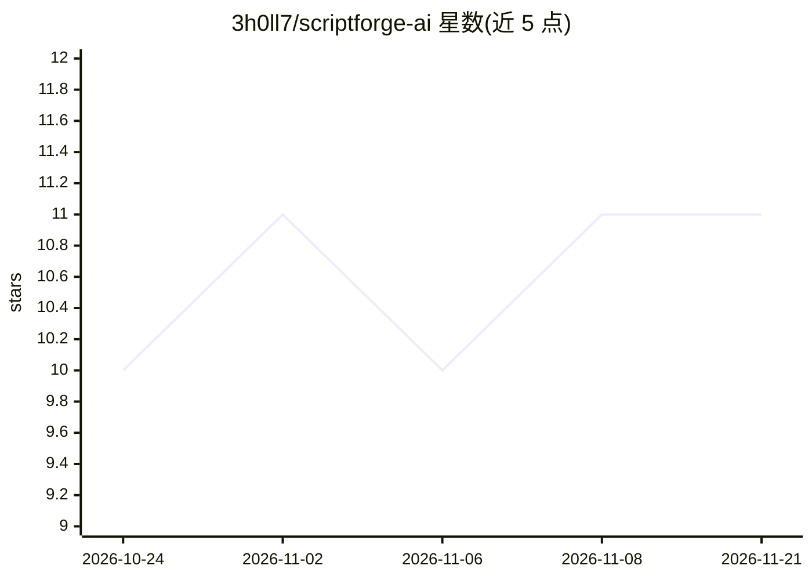

# 3h0ll7/scriptforge-ai

⭐ 11 · TypeScript · 推送 2026-11-16 · [GitHub](https://github.com/3h0ll7/scriptforge-ai) · [官网](https://scriptforgeaii.lovable.app) · 个人维护

**为视频创作者把一个想法生成可拍摄脚本的网络应用**

一个 React + Supabase 构建的 Web 应用：输入想法后生成包含 hook、带时间戳的分镜、B-roll、CTA 和 SEO 标签的视频脚本，支持 YouTube/TikTok/Reels/课程/ webinar 五种平台的时长与语气参数，支持英文与阿拉伯语（RTL）界面。脚本生成与 prompt 增强由 Supabase Edge Functions 承载，后端按顺序尝试 Groq、OpenRouter、Lovable AI Gateway 三个服务商并自动回退。本地运行需 Node.js 18+ 和一个 Supabase 项目，API key 以 Supabase secret 形式配置。无许可证文件，默认保留所有权利。

## 筛选速览

| 维度 | 判定 | 备注 |
|---|---|---|
| AI 角色 | `ai-native` | 本体是模型或模型工具 |
| 许可风险 | `none` | — |
| 部署形态 | `library` | 以包/库形式分发 |
| 模型依赖 | locked-api |  |
| 硬件要求 | — | 无带数字的原话,不猜 |
| 安装摩擦 | `low` | 无编译、无系统依赖或容器化 |
| 成熟度 | — | 结构信号不足 |

## 能力要点

- 生成含 hook、时间戳分镜、B-roll、CTA 与 SEO 标签的完整脚本
- 面向文本到视频模型的分镜 prompt 构建器，一键复制
- Groq → OpenRouter → Lovable AI Gateway 的服务商自动回退链
- 英文与阿拉伯语双语，界面支持原生 RTL 布局

## 适用场景

- 为 YouTube/TikTok/Reels 短视频快速生成拍摄脚本
- 把写好的脚本转成分镜 prompt 交给 AI 视频工具
- 制作阿拉伯语内容的双语脚本

## 场景标签

`AI 写作` · 领域:内容生成

## 证据(README 行号)

> L16:  Turn one idea into a platform-ready video script — hook, timestamps, B-roll, CTA and SEO tags — in seconds.
> L86: |**AI**|Open-weight models via **Groq** (`openai/gpt-oss-120b`, free tier) → **OpenRouter** free models → Lovable A

## 星数曲线

2026-10-24 10 → 2026-11-21 11（+1）

---
*卡片 v1 · prompt 1.4 · 生成 2026-11-19 · 置信度 high · 依据 README sha `1445f07b35ea` · [字段定义](../../DATASET.md)*
