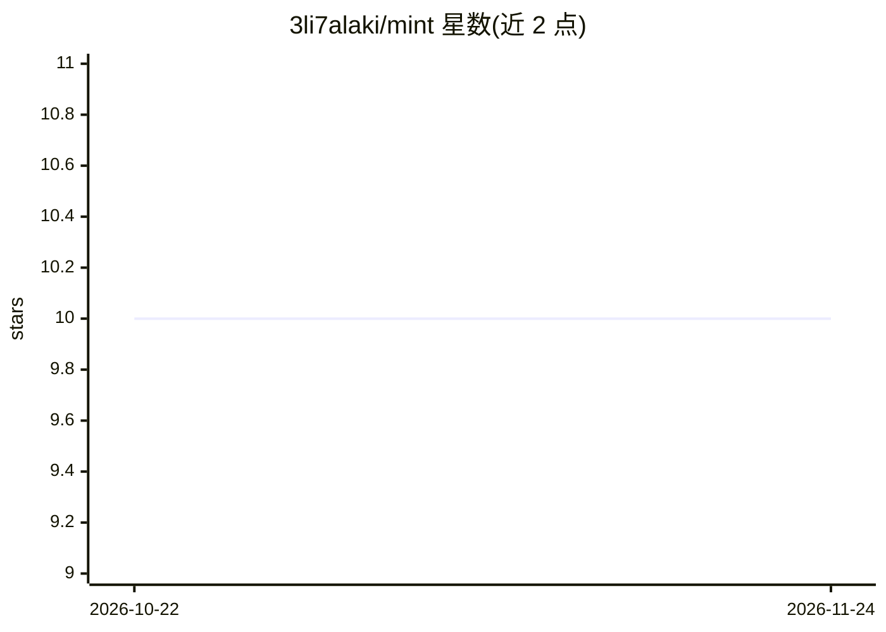

# 3li7alaki/mint

⭐ 10 · Go · MIT · 推送 2026-11-08 · [GitHub](https://github.com/3li7alaki/mint) · [官网](https://mint.area-51.cloud) · 个人维护

**为 agent 完成声明提供独立核验与回执的 CLI**

mint 是一个 Go 编写的静态二进制 CLI，位于 agent 工作流之外充当完成底线的核验层：用户用 spec 定义原子工作单元（目标、范围、EARS 验收标准、gates），mint 在干净的 replay worktree 中运行声明检查，并要求由 mint 自己启动、且与执行者来源不同的 checker 出具审查，通过后签发绑定到确切源码快照的回执，源码变动后回执可被判定为过期。它不管理工单、worktree 或 agent 运行，macOS/Linux 提供单文件安装脚本。边界：与用户同权限运行，无法防御同用户的篡改。

## 筛选速览

| 维度 | 判定 | 备注 |
|---|---|---|
| AI 角色 | `ai-ecosystem` | LLM/agent 周边工具 |
| 许可风险 | `permissive` | MIT |
| 部署形态 | `None` |  |
| 模型依赖 | — | README 未给出锁定关系 |
| 硬件要求 | — | 无带数字的原话,不猜 |
| 安装摩擦 | `low` | 无编译、无系统依赖或容器化 |
| 成熟度 | — | 结构信号不足 |

## 能力要点

- 七条固定底线条款：可验证完成、maker/checker 独立性、反 gaming、scope 等
- gates 在干净 replay worktree 中运行并哈希证明基线字节
- 签发绑定源码快照的回执，可用 receipt verify 检测过期
- 安全相关工作强制要求不同模型 vendor 的 checker

## 适用场景

- 让 AI agent 完成工作后获得可独立核验的完成回执
- 防止 agent 通过扩宽 scope 或伪造报告宣布完成
- 在多 vendor 环境中强制安全审查的独立性

## 场景标签

 · 领域:开发工具/agent 工作流核验

## 证据(README 行号)

> L10: nothing in the loop was ever asked to tell the two apart. mint is a small CLI
> L14: It owns only that. Your driver keeps projects, tickets, terminals, agents,
> L156: - Not a work organizer. Tickets, worktrees, branches and retries stay with your driver.

## 星数曲线

2026-10-22 10 → 2026-11-24 10（+0）

---
*卡片 v1 · prompt 1.4 · 生成 2026-11-20 · 置信度 high · 依据 README sha `e31ab5aa58a4` · [字段定义](../../DATASET.md)*
