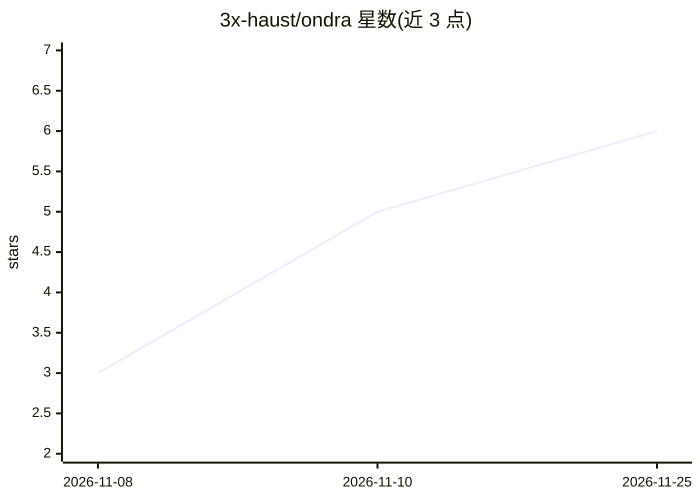

# 3x-haust/ondra

⭐ 6 · TypeScript · MIT · 推送 2026-11-24 · [GitHub](https://github.com/3x-haust/ondra) · [官网](https://github.com/3x-haust/ondra/releases) · 个人维护

**面向 macOS 用户的 AI 任务委派工作区，拆分执行并核验结果**

Ondra 是一款 macOS 桌面应用（Tauri + SolidJS 构建），用户在单一对话中提出需求，应用将请求拆分为并行任务，每个任务拥有独立会话、浏览器标签页与可选 Git worktree。关键机制包括：任务在应用副本中自查（截图与日志留证）、完成报告与记录证据比对、需要用户决策时附带选项提问、深度研究输出带引用的报告与 PDF。支持 computer use、iOS 模拟器/Android 模拟器、定时例程、记忆与 GitHub PR 联动。需 macOS 13+ 与 Apple silicon，模型账号由用户在设置中连接。

## 筛选速览

| 维度 | 判定 | 备注 |
|---|---|---|
| AI 角色 | `ai-native` | 本体是模型或模型工具 |
| 许可风险 | `permissive` | MIT |
| 部署形态 | `desktop` | 安装包/桌面程序 |
| 模型依赖 | — | README 未给出锁定关系 |
| 硬件要求 | — | 无带数字的原话,不猜 |
| 安装摩擦 | `low` | 无编译、无系统依赖或容器化 |
| 成熟度 | — | 结构信号不足 |

## 能力要点

- 一个请求拆分为并行任务，每个任务独立会话与浏览器标签页
- 任务在自身应用副本中验证改动，留存截图与日志作为证据
- 完成报告与任务记录比对，未核验项单独标记
- 支持 iOS 模拟器、Android 模拟器与 computer use 操作

## 适用场景

- 把多个开发改动一次性交给并行的 AI 任务执行
- 让任务自带浏览器完成资料检索并输出带引用的报告
- 在模拟器上验证移动应用的改动结果
- 把日常重复工作设为定时例程自动运行

## 场景标签

`AI 助手` `浏览器自动化` `GUI 自动化` · 领域:效率与自动化

## 证据(README 行号)

> L5:  Put everything you want done in one chat. Ondra splits it into tasks and runs them side by side.
> L24: Main turns your request into tasks that run side by side, each following its part through. The canvas shows how Mai
> L135: 2. Open Ondra and connect a model account, such as ChatGPT/Codex or Claude, in Settings.

## 星数曲线

2026-11-08 3 → 2026-11-25 6（+3）

---
*卡片 v1 · prompt 1.4 · 生成 2026-11-21 · 置信度 mid · 依据 README sha `623a1bfdbaf5` · [字段定义](../../DATASET.md)*
