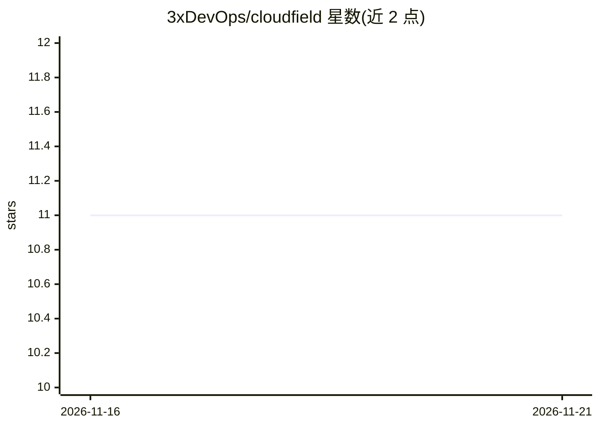

# 3xDevOps/cloudfield

⭐ 11 · Go · GPL-3.0 · 推送 2026-11-20 · [GitHub](https://github.com/3xDevOps/cloudfield) · [官网](https://onaether.dev) · 组织维护

**给团队的自托管云端编码 agent 运行时与协作控制台**

用 Go 编写的自托管系统，分两部分安装：服务端运行在 Linux（含 WSL2）主机上，以容器承载长期运行的编码 agent 会话；桌面客户端与 CLI 覆盖 macOS/Windows/Linux，另有 Android APK 用于访问服务端仪表盘。每个会话对应独立容器与 git 分支，团队成员可实时观察、发消息并接管彼此的 agent，操作归属到人。用户自带 agent CLI 与登录（Claude Code、Codex、OpenCode 等），会话共享按仓库记忆的团队笔记。当前为 beta 状态，许可证为 GPL-3.0。

## 筛选速览

| 维度 | 判定 | 备注 |
|---|---|---|
| AI 角色 | `ai-ecosystem` | LLM/agent 周边工具 |
| 许可风险 | `viral` | GPL-3.0 |
| 部署形态 | `desktop` | 安装包/桌面程序 |
| 模型依赖 | — | README 未给出锁定关系 |
| 硬件要求 | — | 无带数字的原话,不猜 |
| 安装摩擦 | `low` | 无编译、无系统依赖或容器化 |
| 成熟度 | `idea` | |

## 能力要点

- agent 会话在服务器容器中运行，合盖后继续工作，每会话独立容器与 git 分支
- 多人实时观察与接管彼此的 agent，操作归属到人
- 自带 agent CLI 与登录：Claude Code、Codex、OpenCode 等
- 提供桌面客户端、CLI 与 Android APK；支持通过 MCP 连接器从手机 AI 应用启动 agent

## 适用场景

- 团队共享一台服务器运行各自的编码 agent 并互相观察接管
- 让 agent 在合盖笔记本之外的主机上长期运行
- 从手机上通过 Claude/ChatGPT 应用查看并启动服务器上的 agent
- agent 产出的分支直接拉取审查或推送开 PR

## 场景标签

`编码 Agent` · 领域:编码与开发

## 证据(README 行号)

> L12: Cloudfield is a **self-hostable** development environment and control surface for long-running AI coding agents in 
> L84: - You bring your own agent CLIs and logins: Claude Code, Codex, OpenCode and

## 星数曲线

2026-11-16 11 → 2026-11-21 11（+0）

---
*卡片 v1 · prompt 1.4 · 生成 2026-11-19 · 置信度 high · 依据 README sha `89b5c754cc5f` · [字段定义](../../DATASET.md)*
