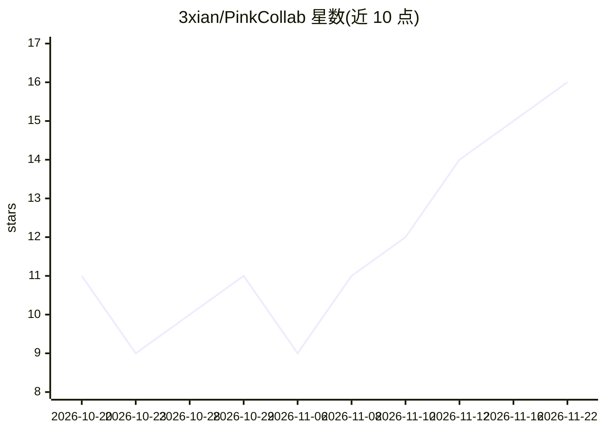

# 3xian/PinkCollab

⭐ 16 · Kotlin · MIT · 推送 2026-11-13 · [GitHub](https://github.com/3xian/PinkCollab) · [官网](https://3xian.github.io/PinkCollab/) · 个人维护

**Android 客户端：从手机远程使用电脑上的 Oh My Pi (OMP)**

PinkCollab 是 Oh My Pi (OMP) 编码 agent 的 Android 客户端：在电脑上运行 npm 安装的 Gateway，手机通过 Tailscale Funnel 公网 HTTPS（或自有反向代理）配对连接，直接读取并继续电脑上已有的 OMP 会话，或在项目目录中启动新会话、左右滑动切换会话、使用斜杠命令与快捷输入。OMP 及其模型供应商配置保留在电脑端；限制包括同一会话不可与终端并行使用、工作区根目录不是操作系统沙箱。需要 Android 8.0+、Node.js 18+、Tailscale（默认方式）。

## 筛选速览

| 维度 | 判定 | 备注 |
|---|---|---|
| AI 角色 | `ai-ecosystem` | LLM/agent 周边工具 |
| 许可风险 | `permissive` | MIT |
| 部署形态 | `library` | 以包/库形式分发 |
| 模型依赖 | — | README 未给出锁定关系 |
| 硬件要求 | — | 无带数字的原话,不猜 |
| 安装摩擦 | `low` | 无编译、无系统依赖或容器化 |
| 成熟度 | — | 结构信号不足 |

## 能力要点

- 直接读取并继续电脑上已有 OMP 会话，无需手动导入
- 默认经 Tailscale Funnel 公网 HTTPS 连接，手机无需安装 Tailscale
- 支持自有 HTTPS 反向代理（Caddy/nginx）的部署方式
- 手机端支持会话滑动切换、斜杠命令、快捷输入与任务删除

## 适用场景

- 在外面用手机继续电脑上未完成的 OMP 编码会话
- 从手机在项目目录中启动新的 OMP 会话并发送提示词
- 管理多个项目的 OMP 会话并随时切换

## 场景标签

`编码 Agent` · 领域:编码与开发

## 证据(README 行号)

> L10: PinkCollab is an **Android client for Oh My Pi (OMP)**. Use OMP on your own computer from your phone.
> L24: On your phone (Android 8.0 or later), install the Android APK.

## 星数曲线

2026-10-20 11 → 2026-11-22 16（+5）

---
*卡片 v1 · prompt 1.4 · 生成 2026-11-18 · 置信度 high · 依据 README sha `b9e76980ab39` · [字段定义](../../DATASET.md)*
