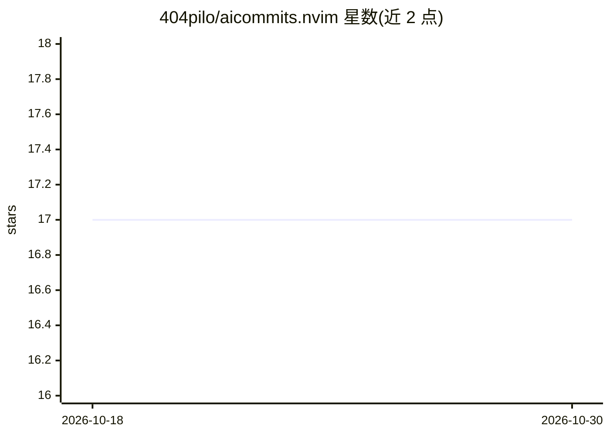

# 404pilo/aicommits.nvim

⭐ 17 · Lua · MIT · 推送 2026-08-01 · [GitHub](https://github.com/404pilo/aicommits.nvim) · 个人维护

**在 Neovim 中用 AI 生成 Conventional Commits 提交信息的插件**

Neovim 插件：暂存改动后运行 :AICommit，读取变更内容并调用 LLM 生成符合 Conventional Commits 格式的提交信息，经选择器确认后创建提交。支持 OpenAI、Google Vertex AI（gcloud 认证、token 缓存 55 分钟）、Gemini API、Anthropic Claude 与 ChatGPT Codex OAuth 会话（默认禁用，附风险披露）五种 provider，并提供 Neogit 集成。要求 Neovim 0.9+、Git、curl，除 Codex 外各 provider 需 API key 或 GCP 凭据。

## 筛选速览

| 维度 | 判定 | 备注 |
|---|---|---|
| AI 角色 | `ai-native` | 本体是模型或模型工具 |
| 许可风险 | `permissive` | MIT |
| 部署形态 | `None` |  |
| 模型依赖 | locked-api |  |
| 硬件要求 | — | 无带数字的原话,不猜 |
| 安装摩擦 | `low` | 无编译、无系统依赖或容器化 |
| 成熟度 | — | 结构信号不足 |

## 能力要点

- 支持 OpenAI / Vertex AI / Gemini API / Anthropic / Codex 五种 provider
- 生成 Conventional Commits 格式提交并通过选择器确认
- Neogit 集成（状态缓冲区按 C 触发）
- 支持自定义 OpenAI 兼容端点与 :AICommitHealth 健康检查命令

## 适用场景

- 在 Neovim 内一键生成规范的 git 提交信息
- 团队统一 Conventional Commits 提交格式
- 切换不同 LLM 提供商生成提交信息

## 场景标签

`代码生成` · 领域:编码与开发

## 证据(README 行号)

> L3: AI-powered git commit messages directly in Neovim.
> L11: This plugin generates conventional commit messages using AI. Stage your changes, run `:AICommit`, and get a properl
> L230: - **OpenAI** - OpenAI GPT models (default)

## 星数曲线

2026-10-18 17 → 2026-10-30 17（+0）

---
*卡片 v1 · prompt 1.4 · 生成 2026-10-30 · 置信度 high · 依据 README sha `e3aadc8618dd` · [字段定义](../../DATASET.md)*
