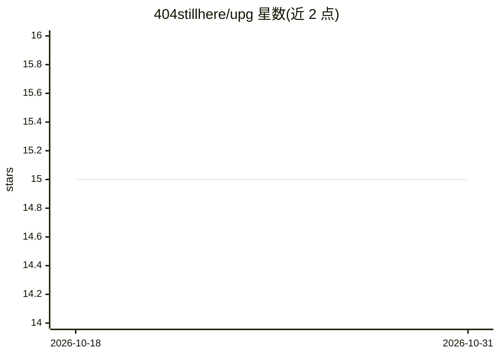

# 404stillhere/upg

⭐ 15 · Python · NOASSERTION · 推送 2026-09-06 · [GitHub](https://github.com/404stillhere/upg) · [官网](https://github.com/404stillhere/upg/blob/master/full_versions/UPG_v10.md) · 个人维护

**文生图模型提示词生成系统提示词，含安全与漂移控制**

UPG 是一个约 30KB 的大型系统提示词文本：粘贴进 ChatGPT、Claude 等推理模型后，输入主题即可产出 1/3/5 条面向 Midjourney、Flux、Stable Diffusion 等模型的可用提示词。内含六阶段流水线、安全改写层、禁用词登记表、S1–S5 槽位系统与九层验证。仓库定位为个人研究档案：保留 35 个历史版本快照供设计决策溯源；最新 v10 未公开，仓库内最后完整版本为 v9.15，使用方式是复制文件粘贴，非软件安装。许可为 All Rights Reserved，非开源。

## 筛选速览

| 维度 | 判定 | 备注 |
|---|---|---|
| AI 角色 | `ai-native` | 本体是模型或模型工具 |
| 许可风险 | `none` | NOASSERTION |
| 部署形态 | `None` |  |
| 模型依赖 | — | README 未给出锁定关系 |
| 硬件要求 | — | 无带数字的原话,不猜 |
| 安装摩擦 | `low` | 无编译、无系统依赖或容器化 |
| 成熟度 | — | 结构信号不足 |

## 能力要点

- 六阶段流水线并在每阶段边界设验证门
- 安全改写层处理真人、商标 IP、暴力与仇恨内容
- BAN REGISTRY 禁用词表与 S1–S5 槽位系统（含 Ring Test）
- 32 项测试覆盖 18 个 LLM 的验证记录（BENCHMARK.md）

## 适用场景

- 为 Midjourney/Flux/Stable Diffusion 等模型批量生成主题提示词
- 研究提示词工程系统的迭代与设计决策
- 用配套 Checklist/分析协议做主题访谈与生成后审计

## 场景标签

`提示工程` · 领域:Agent 开发

## 证据(README 行号)

> L23: **UPG** (Universal Prompt Generator) is a large system prompt that you paste into ChatGPT, Claude, or any capable r
> L137: 1. Open full_versions/UPG_v9_15.md — the last complete standalone prompt in the repo (later 9.x files are incremen
> L140: 4. Read the output, copy any of the 1/3/5 prompts into your image model.

## 星数曲线

2026-10-18 15 → 2026-10-31 15（+0）

---
*卡片 v1 · prompt 1.4 · 生成 2026-10-31 · 置信度 mid · 依据 README sha `b9c51079a93f` · [字段定义](../../DATASET.md)*
