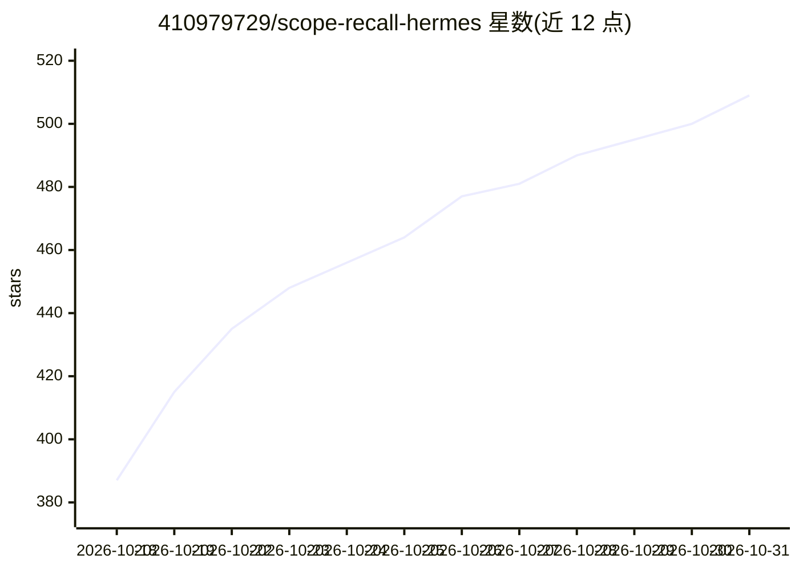

# 410979729/scope-recall-hermes

⭐ 509 · Python · MIT · 推送 2026-10-29 · [GitHub](https://github.com/410979729/scope-recall-hermes) · 个人维护 · 中文 README

**多 agent 共享的本地长期记忆核心：SQLite 事实库+向量检索**

为 Hermes、Codex、Claude Code、WorkBuddy、dsh 等 agent 提供的本地长期记忆核心：SQLite 作为唯一事实权威，LanceDB 作为可重建的向量伴随索引；多个 agent 可作为条目接入同一共享存储，互相召回彼此记录的记忆，且每条记忆记录来源 agent。提供 hooks 与 MCP 服务器（需 codex extra）、记忆浏览/更正/静音/删除的管理 CLI、导出为可移植包、多跳证据 trace 工具。事实由累积证据形成，仅 owner 显式更正可变更；默认向量后端需 LanceDB extra，否则退化为词法召回。

## 筛选速览

| 维度 | 判定 | 备注 |
|---|---|---|
| AI 角色 | `ai-ecosystem` | LLM/agent 周边工具 |
| 许可风险 | `permissive` | MIT |
| 部署形态 | `library` | 以包/库形式分发 |
| 模型依赖 | — | README 未给出锁定关系 |
| 硬件要求 | — | 无带数字的原话,不猜 |
| 安装摩擦 | `low` | 无编译、无系统依赖或容器化 |
| 成熟度 | — | 结构信号不足 |

## 能力要点

- SQLite 为唯一事实权威，向量索引为可重建伴随组件
- 多 agent（Hermes/Codex/Claude Code/WorkBuddy/dsh）共享同一存储并标记记忆来源
- scope-recall memory CLI 浏览、更正、静音、删除记忆，不做模型请求
- profile/entity 只读视图与有界多跳 trace 工具

## 适用场景

- 让多个本地 agent 共享一份带来源的长期记忆
- 检查并更正或删除 agent 记住的关于自己的内容
- 跨多条已记录关系做多跳证据查询

## 场景标签

`Agent 记忆` · 领域:Agent 开发

## 证据(README 行号)

> L3: Scope Recall v3 is a bounded local memory core with SQLite as the authority and rebuildable vector companions. It pr
> L21: is captured. SQLite is the only fact authority; host adapters share the same
> L33: Use `scope-recall memory` to browse, search, inspect history, correct a fact, mute it or delete a conversation.

## 星数曲线

2026-10-18 387 → 2026-10-31 509（+122）

---
*卡片 v1 · prompt 1.4 · 生成 2026-10-21 · 置信度 high · 依据 README sha `3867b613e903` · [字段定义](../../DATASET.md)*
