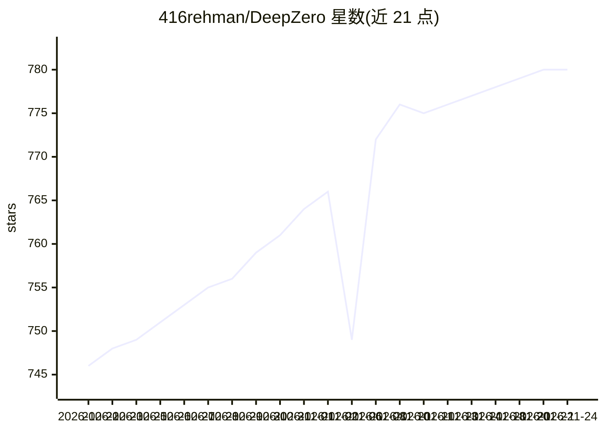

# 416rehman/DeepZero

⭐ 780 · Python · MIT · 推送 2026-11-01 · [GitHub](https://github.com/416rehman/DeepZero) · [官网](http://blog.ahmadz.ai/DeepZero/) · 个人维护

**AI 驱动的漏洞研究流水线：批量分析 Windows 内核驱动 IOCTL**

以 YAML 定义流水线的自动化漏洞研究引擎，将解析、反编译与 LLM 评估等阶段组合为可并行执行的管道，支持中断恢复、增量重跑与自定义 Python 处理器；LLM 后端通过 LiteLLM 或 Claude Code CLI 接入，可用 -m 指定如 openai/gpt-4o。内置 demo 无需 API key 即可运行；内核驱动分析需自备 Ghidra、JDK 与驱动语料，源码审计需 Semgrep 与 Git。提供 HTML 报告生成与实验性 REST API。

## 筛选速览

| 维度 | 判定 | 备注 |
|---|---|---|
| AI 角色 | `ai-native` | 本体是模型或模型工具 |
| 许可风险 | `permissive` | MIT |
| 部署形态 | `library` | 以包/库形式分发 |
| 模型依赖 | — | README 未给出锁定关系 |
| 硬件要求 | — | 无带数字的原话,不猜 |
| 安装摩擦 | `low` | 无编译、无系统依赖或容器化 |
| 成熟度 | — | 结构信号不足 |

## 能力要点

- YAML 流水线组合解析、过滤、转换与 LLM 评估阶段
- 并行执行、断点恢复与增量重跑（提示词变更只重跑受影响阶段）
- LLM 后端支持 LiteLLM（如 openai/gpt-4o）与 Claude Code CLI
- deepzero report 生成自包含 HTML 报告，附实验性 REST API

## 适用场景

- 批量审计 Windows 内核驱动中的可利用 IOCTL
- 对多个代码仓库做自动化源码安全审计
- 用 YAML 组合 LLM 评估阶段构建可复现的分析流水线

## 场景标签

`网络安全` `代码审查` · 领域:编码与开发

## 证据(README 行号)

> L3:  Automated vulnerability research pipeline engine
> L21: - **YAML pipelines** - combine ingestion, filtering, transformation, and LLM assessment stages.
> L25: - **LLM backends** - use Jinja2 prompts with LiteLLM or the Claude Code CLI.

## 星数曲线

2026-10-22 746 → 2026-11-24 780（+34）

---
*卡片 v1 · prompt 1.4 · 生成 2026-11-24 · 置信度 high · 依据 README sha `ee62ec5cb5b6` · [字段定义](../../DATASET.md)*
