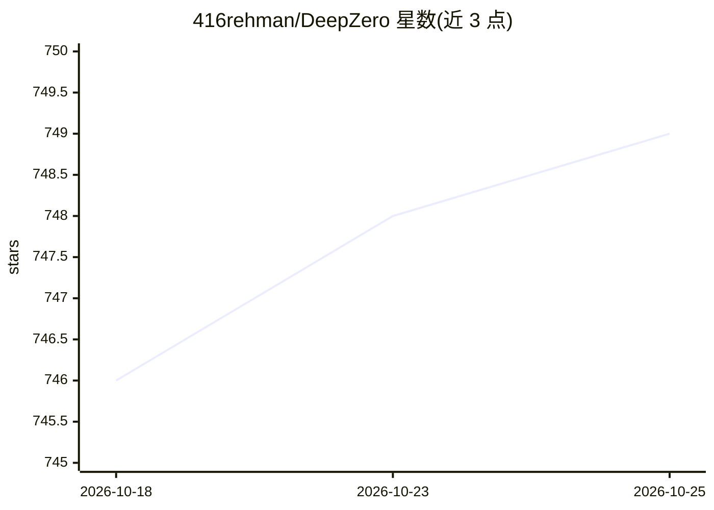

# 416rehman/DeepZero

⭐ 749 · Python · MIT · 推送 2026-09-10 · [GitHub](https://github.com/416rehman/DeepZero) · [官网](http://blog.ahmadz.ai/DeepZero/) · 个人维护 · 中文 README

**以 YAML 定义流水线的自动化漏洞研究引擎（LLM 集成）**

面向 Windows 内核驱动漏洞研究的流水线编排引擎：用 YAML 声明式串联 ingest、filter、transform 与 LLM-assess 阶段，由引擎负责编排、并发、容错与磁盘上的可恢复状态；LLM 接入通过 LiteLLM 适配任意提供商，提示词用 Jinja2 模板编写；可写自定义 Python 处理器在 YAML 中按路径引用。内置文本示例演示无需 API key、Ghidra 与驱动语料即可本地运行，驱动分析流水线需另行按完整设置指南配置依赖。REST API 为实验性未完成功能。

## 筛选速览

| 维度 | 判定 | 备注 |
|---|---|---|
| AI 角色 | `ai-ecosystem` | LLM/agent 周边工具 |
| 许可风险 | `permissive` | MIT |
| 部署形态 | `library` | 以包/库形式分发 |
| 模型依赖 | — | README 未给出锁定关系 |
| 硬件要求 | — | 无带数字的原话,不猜 |
| 安装摩擦 | `low` | 无编译、无系统依赖或容器化 |
| 成熟度 | `idea` | |

## 能力要点

- Pipeline-as-YAML 声明式编排，含并行执行与可恢复状态
- 经 LiteLLM 接入任意 LLM 提供商，Jinja2 提示模板
- 自定义处理器以 Python 类扩展
- 附带无需 API key 的本地文本示例演示

## 适用场景

- 批量解析与筛选驱动样本并生成可浏览的 HTML 报告
- 构建含 LLM 评估阶段的漏洞研究流水线
- 中断后从已保存状态续跑长任务

## 场景标签

`工作流自动化` `网络安全` · 领域:效率与自动化

## 证据(README 行号)

> L16: - 🔗 **Pipeline-as-YAML** - chain ingest, filter, transform, and LLM-assess stages declaratively
> L19: - 🤖 **LLM integration** - Jinja2 prompt templates with any LLM provider via LiteLLM

## 星数曲线

2026-10-18 746 → 2026-10-25 749（+3）

---
*卡片 v1 · prompt 1.4 · 生成 2026-10-21 · 置信度 high · 依据 README sha `a878c190285d` · [字段定义](../../DATASET.md)*
