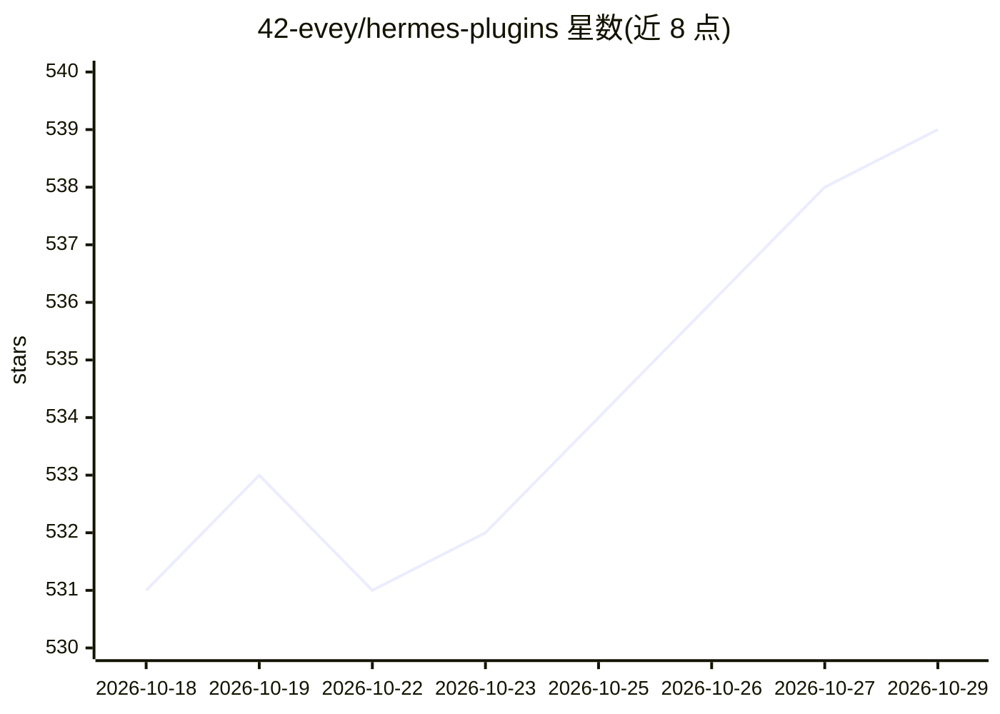

# 42-evey/hermes-plugins

⭐ 539 · Python · MIT · 推送 2026-10-24 · [GitHub](https://github.com/42-evey/hermes-plugins) · [官网](https://evey.cc) · 个人维护

**hermes-agent 的 23 个自定义插件：自主决策/遥测/成本控制**

面向 hermes-agent 自主代理的 23 个插件集，覆盖五个方向：自主决策（自主引擎、3 模型辩论、多模型路由与 4 级回退）、可观测性（JSON 遥测、统一状态、MQTT 事件流、Langfuse 预算控制）、质量与安全（自我纠错、幻觉检测、提示注入筛查、沙箱执行）、学习与记忆（经验学习、记忆重要度衰减与夜间整合、委托缓存）、通信集成（与 Claude Code 双向桥、目标管理、Telegram UX、自动研究管线）。通过 git clone 拷贝到 ~/.hermes/plugins/ 安装，MIT 许可。

## 筛选速览

| 维度 | 判定 | 备注 |
|---|---|---|
| AI 角色 | `ai-ecosystem` | LLM/agent 周边工具 |
| 许可风险 | `permissive` | MIT |
| 部署形态 | `None` |  |
| 模型依赖 | local-ok | 支持本地模型 |
| 硬件要求 | — | 无带数字的原话,不猜 |
| 安装摩擦 | `low` | 无编译、无系统依赖或容器化 |
| 成熟度 | — | 结构信号不足 |

## 能力要点

- evey-autonomy 提供自主决策/规划/反思工具，evey-council 用 3 模型辩论提取共识
- evey-delegate-model 按任务类型自动路由模型，含 3 次重试与 4 模型回退链
- evey-cost-guard 经 Langfuse 做每日/单任务预算控制（80% 告警、100% 警报）
- evey-bridge 以文件收件箱/发件箱 + MCP server 与 Claude Code 双向通信

## 适用场景

- 为 hermes-agent 增加自主运行所需的决策与目标管理能力
- 追踪 agent 的工具调用、委托与成本开销
- 给 agent 加装幻觉检测、提示注入筛查与沙箱执行等安全层
- 让 agent 维护可衰减与夜间整合的长期记忆

## 场景标签

`Agent 记忆` `LLM 可观测性` · 领域:Agent 开发

## 证据(README 行号)

> L5: 23 custom plugins for hermes-agent — built for autonomous operation, observability, cost control, and self-improveme
> L21: |**evey-autonomy**|Core autonomy engine: autonomous_decide, autonomous_plan, autonomous_reflect tools. The brain of
> L68: These plugins are part of Evey's autonomous AI agent stack:

## 星数曲线

2026-10-18 531 → 2026-10-29 539（+8）

---
*卡片 v1 · prompt 1.4 · 生成 2026-10-21 · 置信度 high · 依据 README sha `b2c2cbcceba6` · [字段定义](../../DATASET.md)*
