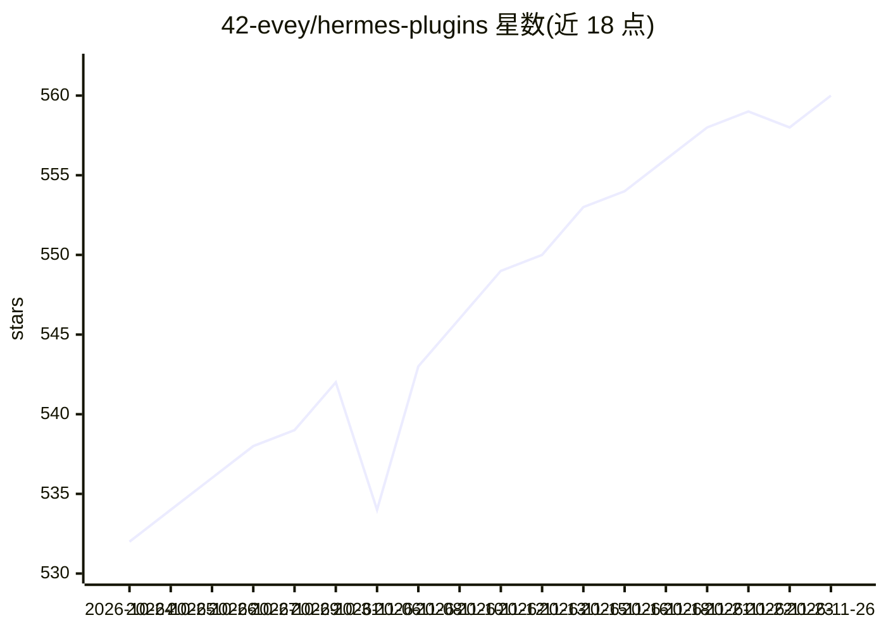

# 42-evey/hermes-plugins

⭐ 560 · Python · MIT · 推送 2026-10-24 · [GitHub](https://github.com/42-evey/hermes-plugins) · [官网](https://evey.cc) · 个人维护

**为 Hermes Agent 提供目标管理、代理桥接、成本控制等插件与技能集**

面向 Hermes Agent 的插件与技能集合，按自治决策、质量安全、记忆学习、可观测性、集成五类组织，约 20 余个插件与 6 个工作流技能。插件经 `hermes plugins doctor --ci` 与 `plugins validate` 校验（基于 Hermes v0.22.5）。插件通过 `ctx.llm` 调用模型，使用用户已配置的任意 provider（含本地模型）。安装以单文件夹为单位，默认禁用需手动开启；外部服务通过环境变量提供地址与密钥。MIT 许可。

## 筛选速览

| 维度 | 判定 | 备注 |
|---|---|---|
| AI 角色 | `ai-ecosystem` | LLM/agent 周边工具 |
| 许可风险 | `permissive` | MIT |
| 部署形态 | `None` |  |
| 模型依赖 | local-ok | 支持本地模型 |
| 硬件要求 | — | 无带数字的原话,不猜 |
| 安装摩擦 | `low` | 无编译、无系统依赖或容器化 |
| 成熟度 | — | 结构信号不足 |

## 能力要点

- 目标管理、多角色问答、任务委派与结果评分等自治类插件
- 幻觉标记、提示注入邮件筛查、PII 脱敏沙箱等安全类插件
- 经 Langfuse 提供成本预算与分解（evey-cost-guard）
- 插件按 provider 无关方式经 ctx.llm 调用，支持本地模型

## 适用场景

- 为 Hermes Agent 补充目标队列、规划与反思能力
- 对委派任务的输出做幻觉与错误校验
- 监控 agent 的成本、事件与运行状态
- 把 Hermes agent 与 Claude Code 会话或 Telegram 网关打通

## 场景标签

`Agent 框架` `LLM 可观测性` · 领域:Agent 开发

## 证据(README 行号)

> L5: Plugins and skills for Hermes Agent. Checked on
> L50: Plugins that need a model call it through `ctx.llm`, so they run on whatever provider and model

## 星数曲线

2026-10-24 532 → 2026-11-26 560（+28）

---
*卡片 v1 · prompt 1.4 · 生成 2026-11-25 · 置信度 high · 依据 README sha `b3ec85a66e44` · [字段定义](../../DATASET.md)*
