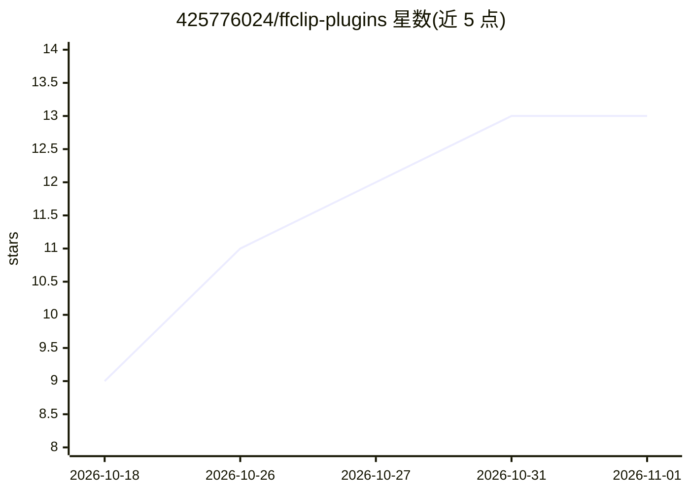

# 425776024/ffclip-plugins

⭐ 13 · JavaScript · MIT · 推送 2026-10-08 · [GitHub](https://github.com/425776024/ffclip-plugins) · [官网](https://ffclip.com/webcut) · 个人维护 · 中文 README

**MCP 视频剪辑工具：让 AI 助手完成粗剪，时间线上精修**

面向 AI 助手的视频剪辑工具（npm 包 @ffclip-com/videocut，需 Node.js 22+）：通过对话让助手完成第一版剪辑，随后在时间线上手动精修。功能包括裁剪片段、添加本地配音与字幕、实时预览、导出 MP4/WebM、保存工程继续编辑；内置 10 个 PAGX 动效模板（中英双语，可编辑文字/颜色/形状），动画渲染与导出不依赖逐帧浏览器截图；生成新配音需下载模型。以 MIT 许可发布，含 WebAV 等第三方组件。

## 筛选速览

| 维度 | 判定 | 备注 |
|---|---|---|
| AI 角色 | `ai-enhanced` | 去掉 AI 部分产品仍成立 |
| 许可风险 | `permissive` | MIT |
| 部署形态 | `None` |  |
| 模型依赖 | — | README 未给出锁定关系 |
| 硬件要求 | — | 无带数字的原话,不猜 |
| 安装摩擦 | `low` | 无编译、无系统依赖或容器化 |
| 成熟度 | — | 结构信号不足 |

## 能力要点

- 对话式粗剪 + 时间线精修的工作流
- 10 个可编辑的 PAGX 原生动效模板（中英双语）
- 本地配音、字幕、实时预览，导出 MP4/WebM
- 工程可保存以便继续编辑

## 适用场景

- 用对话让 AI 助手快速完成视频第一版剪辑
- 剪辑带配音和字幕的解说视频
- 使用现成动效模板制作片头动画

## 场景标签

`视频生成` · 领域:内容生成

## 证据(README 行号)

> L8: Install the latest @ffclip-com/videocut from npm and connect it to this assistant.
> L13: **Describe the video. Let your assistant make the first cut. Refine it on the timeline.**
> L19: Trim clips, add local voiceover and captions, preview live, and export MP4 or WebM. Save the complete project to ke

## 星数曲线

2026-10-18 9 → 2026-11-01 13（+4）

---
*卡片 v1 · prompt 1.4 · 生成 2026-10-31 · 置信度 mid · 依据 README sha `ae51a52a702e` · [字段定义](../../DATASET.md)*
