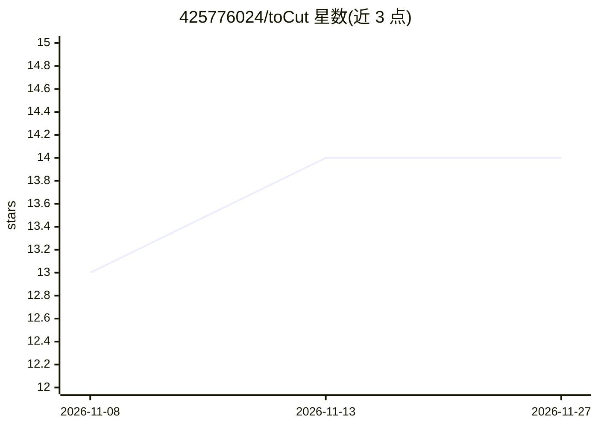

# 425776024/toCut

⭐ 14 · JavaScript · MIT · 推送 2026-11-14 · [GitHub](https://github.com/425776024/toCut) · [官网](https://ffclip.com/webcut) · 个人维护 · 中文 README

**对话式视频剪辑工具：AI 生成初剪，时间轴上精修**

面向视频创作者的网页端剪辑工具：通过自然语言向 AI 助手描述内容，由助手安装并调用剪辑工具完成初剪，再在时间轴上精修。支持裁剪片段、添加本地配音与字幕、实时预览、导出 MP4/WebM，项目可保存续编。内置 10 个 PAGX 动效模板（中英双语），动画播放与导出使用原生渲染而非逐帧浏览器截图；本地中文语音合成需下载模型。

## 筛选速览

| 维度 | 判定 | 备注 |
|---|---|---|
| AI 角色 | `ai-native` | 本体是模型或模型工具 |
| 许可风险 | `permissive` | MIT |
| 部署形态 | `None` |  |
| 模型依赖 | — | README 未给出锁定关系 |
| 硬件要求 | — | 无带数字的原话,不猜 |
| 安装摩擦 | `low` | 无编译、无系统依赖或容器化 |
| 成熟度 | — | 结构信号不足 |

## 能力要点

- 对话式初剪：复制提示词接入 AI 助手，从会话生成可编辑视频
- 10 个原生 PAGX 动效模板，中英双语，文本/颜色/形状可编辑
- 动画播放与导出采用原生渲染，不逐帧截屏
- 本地语音合成与可编辑字幕分轨

## 适用场景

- 让 AI 根据描述先出一版剪辑，再在时间轴上精修
- 制作带中文字幕与配音的解说视频
- 套用动效模板快速做片头/数据展示片段

## 场景标签

`视频生成` `语音合成` · 领域:内容生成

## 证据(README 行号)

> L5:  Copy this into your AI assistant
> L13: **Describe the video. Let your assistant make the first cut. Refine it on the timeline.**
> L19: Trim clips, add local voiceover and captions, preview live, and export MP4 or WebM. Save the complete project to ke

## 星数曲线

2026-11-08 13 → 2026-11-27 14（+1）

---
*卡片 v1 · prompt 1.4 · 生成 2026-11-18 · 置信度 mid · 依据 README sha `03058b19c391` · [字段定义](../../DATASET.md)*
