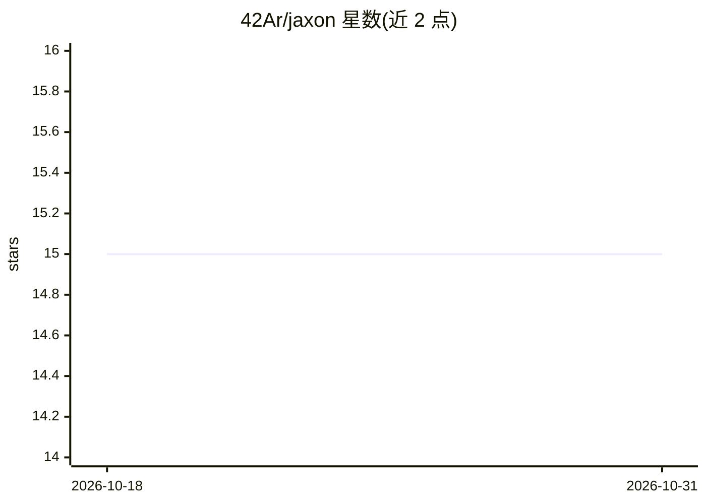

# 42Ar/jaxon

⭐ 15 · Python · GPL-3.0 · 推送 2026-10-26 · [GitHub](https://github.com/42Ar/jaxon) · 个人维护

**Python 库：将 pytree 结构高效存取为 HDF5 文件**

面向机器学习与科学计算场景的 Python 序列化库，功能限定为保存与加载任意嵌套 pytree（列表/元组/字典/集合/dataclass/NumPy/JAX 数组等）到自描述的 HDF5 文件，可用 h5dump、HDFView 等标准工具检视。机制上保存足够的类型信息以精确重建原对象与引用同一性，支持 schema 演化选项、to_jaxon/from_jaxon 自定义类型接口、marshaler 函数、dill 兜底（需显式开启）及 load_filter 部分加载。需 Python ≥ 3.10，pip 安装。与 Equinox 等 dataclass/JAX 生态兼容。

## 筛选速览

| 维度 | 判定 | 备注 |
|---|---|---|
| AI 角色 | `ai-ecosystem` | LLM/agent 周边工具 |
| 许可风险 | `viral` | GPL-3.0 |
| 部署形态 | `library` | 以包/库形式分发 |
| 模型依赖 | — | README 未给出锁定关系 |
| 硬件要求 | — | 无带数字的原话,不猜 |
| 安装摩擦 | `low` | 无编译、无系统依赖或容器化 |
| 成熟度 | — | 结构信号不足 |

## 能力要点

- 精确还原类型与引用同一性（同一对象多处出现加载后仍为同一对象）
- 自定义类型接口：to_jaxon/from_jaxon、marshaler 函数、dill 兜底
- load_filter 支持大型 pytree 部分加载
- 输出格式自描述，可被标准 HDF5 工具读取

## 适用场景

- 保存/加载 Equinox 等 JAX 模型参数与嵌套 dataclass
- 以可检视的 HDF5 格式长期保存科学计算数据
- 只加载大型 pytree 中需要的部分节点

## 场景标签

 · 领域:科学计算/数据序列化

## 证据(README 行号)

> L6: Jaxon is a focused Python library for saving and loading arbitrary nested data structures
> L14: Jaxon is well suited for machine learning and scientific computing. It is especially
> L16: JAX, such as Equinox.

## 星数曲线

2026-10-18 15 → 2026-10-31 15（+0）

---
*卡片 v1 · prompt 1.4 · 生成 2026-10-31 · 置信度 high · 依据 README sha `bcc6a8d4db59` · [字段定义](../../DATASET.md)*
