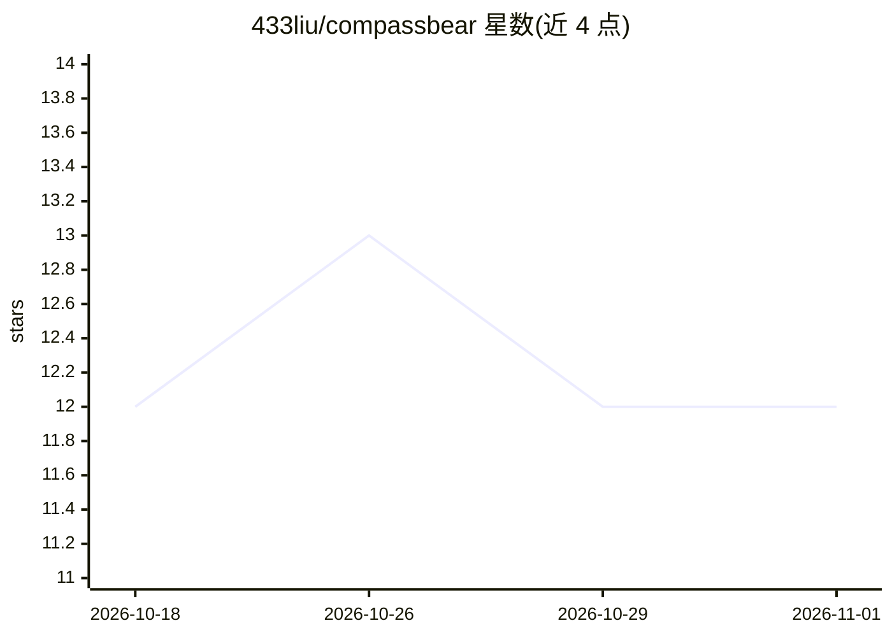

# 433liu/compassbear

⭐ 12 · Markdown · MIT · 推送 2026-06-06 · [GitHub](https://github.com/433liu/compassbear) · 个人维护 · 中文 README

**科研论文“可防御性”写作技能包：审计声明、规划图表与审稿风险**

面向 Claude Code 与 Codex 的 claim-first 科研写作技能树：单一根技能 compass-bear 路由到写作、图表策略、一致性审计、研究委员会辩论、求职信、审稿回复、SI/Methods 与专利式边界等模块。它将数据、机制、图表与应用重组为可辩护的稿件结构：判定过度声明、给出更安全的降级表述、映射审稿风险并规划补充证据。参考案例主要来自材料与化学工作流，声明领域无关。以 git clone 源码安装为本地技能使用，公共包不含私有数据。

## 筛选速览

| 维度 | 判定 | 备注 |
|---|---|---|
| AI 角色 | `ai-native` | 本体是模型或模型工具 |
| 许可风险 | `permissive` | MIT |
| 部署形态 | `None` |  |
| 模型依赖 | — | README 未给出锁定关系 |
| 硬件要求 | — | 无带数字的原话,不猜 |
| 安装摩擦 | `low` | 无编译、无系统依赖或容器化 |
| 成熟度 | — | 结构信号不足 |

## 能力要点

- 声明层级审计：判定 overclaimed 并给出降级表述
- 图表作为论证：面板归属 main/Extended Data/SI 的规划
- 期刊定位对比（Nature-family/JACS/Angew/AM）与求职信、逐条回复规划
- 单一根技能路由多个子模块，无重型框架依赖

## 适用场景

- 投稿前审计摘要与声明是否被证据支撑
- 规划 Figure 2 的面板布局与 Extended Data/SI 归属
- 比较不同期刊定位下的声明上限
- 准备 rebuttal 的逐条回复计划

## 场景标签

`提示工程` `科研工具` `AI 写作` · 领域:Agent 开发

## 证据(README 行号)

> L3: **The claim-first research-writing skill for Claude Code & Codex.**
> L19: CompassBear turns scattered data, mechanisms, figures and applications into **defensible** manuscripts, proposals, 
> L103: A single root skill, `compass-bear`, routes to focused modules: writing, figure strategy, consistency audit, resea

## 星数曲线

2026-10-18 12 → 2026-11-01 12（+0）

---
*卡片 v1 · prompt 1.4 · 生成 2026-11-01 · 置信度 high · 依据 README sha `0683ae1f5354` · [字段定义](../../DATASET.md)*
