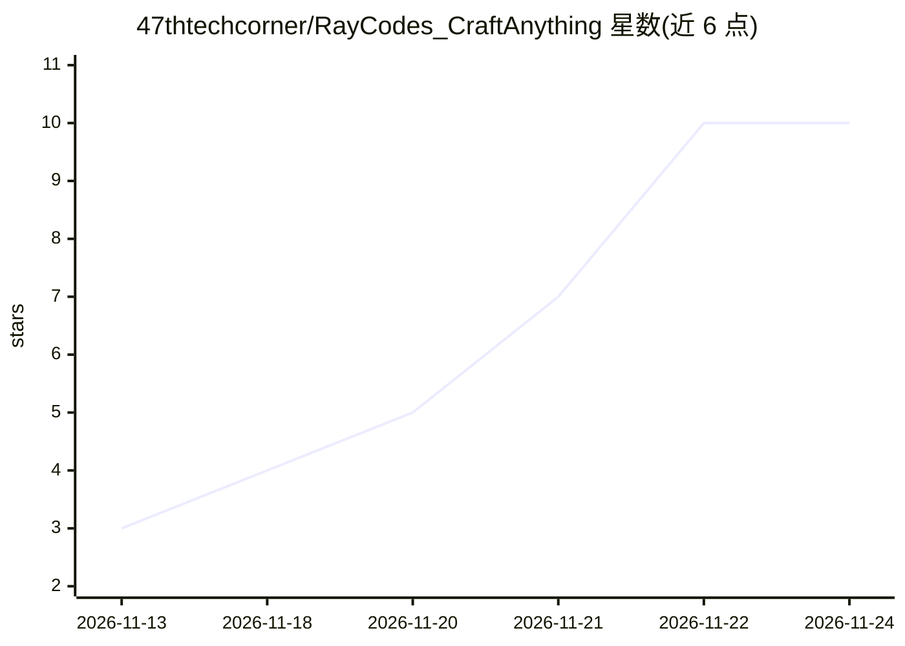

# 47thtechcorner/RayCodes_CraftAnything

⭐ 10 · HTML · MIT · 推送 2026-11-09 · [GitHub](https://github.com/47thtechcorner/RayCodes_CraftAnything) · [官网](https://youtu.be/eeaPJOVtqVc) · 个人维护

**为本地编码 Agent 提供 320 个 Rust 检查探针的 UI 净室重建引擎**

以纯 Rust 实现的净室逆向与重建引擎，通过 MCP 协议向本地编码 Agent 暴露 320 个编译的检查探针，用于从抓取的 HTML/规格文件中隔离 DOM 层级、排版尺度与设计令牌，并重建出 Tailwind 仪表盘、canvas 游戏或多步表单向导等交付物。README 给出 PowerShell 一键脚本：git clone 后经 cargo 安装 CLI、执行 doctor 检查并启动 MCP 服务。声明本地占用 4GB VRAM / 16GB RAM，并附带 Antigravity Agent 的注册与任务提示词示例。

## 筛选速览

| 维度 | 判定 | 备注 |
|---|---|---|
| AI 角色 | `ai-ecosystem` | LLM/agent 周边工具 |
| 许可风险 | `permissive` | MIT |
| 部署形态 | `library` | 以包/库形式分发 |
| 模型依赖 | — | README 未给出锁定关系 |
| 硬件要求 | `gpu-8g` | |
| 安装摩擦 | `low` | 无编译、无系统依赖或容器化 |
| 成熟度 | — | 结构信号不足 |

## 能力要点

- 320 个编译 Rust 检查探针，经 MCP 协议暴露给本地编码 Agent
- 净室方式重建：不接触专有源码，产出 Tailwind 页面/canvas 游戏/多步向导
- 单条 PowerShell 命令完成 clone、cargo 编译、doctor 校验与 MCP 服务启动
- 提供 Google Antigravity Agent 的自动注册与任务提示词

## 适用场景

- 把旧版 SaaS 管理后台重建为现代响应式 Tailwind 仪表盘
- 从游戏物理规格提取碰撞与时序参数，重建可玩的 canvas 小游戏
- 在不下载跟踪脚本的情况下抓取干净的 DOM 层级与设计令牌

## 场景标签

`代码生成` · 领域:编码与开发

## 证据(README 行号)

> L12: Protocol: Model Context Protocol
> L15: > *"Craft Anything shifts reverse engineering from high-risk binary deconstruction into safe, clean-room functional
> L35: craft-anything-cli mcp

## 星数曲线

2026-11-13 3 → 2026-11-24 10（+7）

---
*卡片 v1 · prompt 1.4 · 生成 2026-11-21 · 置信度 mid · 依据 README sha `f652cd845b77` · [字段定义](../../DATASET.md)*
