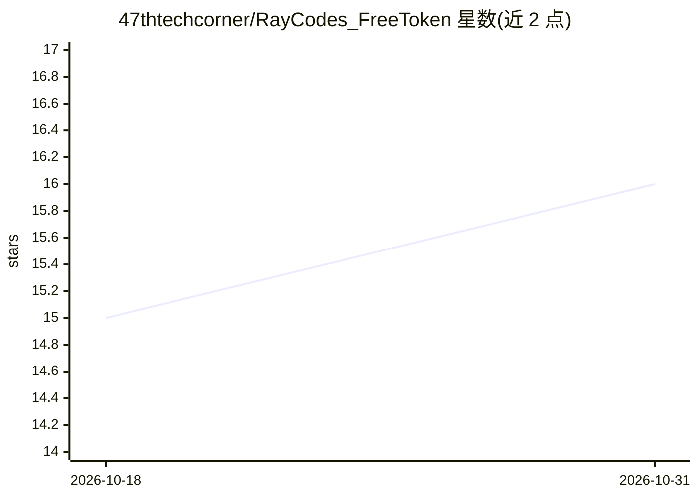

# 47thtechcorner/RayCodes_FreeToken

⭐ 16 · Python · 推送 2026-08-23 · [GitHub](https://github.com/47thtechcorner/RayCodes_FreeToken) · [官网](https://youtu.be/kdoP47Xtpjw) · 个人维护

**面向低显存消费级 GPU 的本地 MoE 推理服务引擎**

FreeToken 是一个边缘端 Mixture-of-Experts 推理服务引擎，用于在消费级硬件（如游戏 PC、4GB 显存）上本地运行大规模开源权重模型。提供 hybrid/offload/fused/cpu/auto 多种 MoE 执行后端、弹性 VRAM 重新分配、语义 KV 状态缓存，并暴露 OpenAI REST API 与 Anthropic Messages API 兼容端点。模型检查点通过 Ollama 注册（Modelfile 指定 GGUF 路径），可用 uv/pip 安装或下载 Windows/Linux 桌面应用；项目附带了 YouTube 视频教程。

## 筛选速览

| 维度 | 判定 | 备注 |
|---|---|---|
| AI 角色 | `ai-ecosystem` | LLM/agent 周边工具 |
| 许可风险 | `none` | — |
| 部署形态 | `library` | 以包/库形式分发 |
| 模型依赖 | local-ok | 支持本地模型 |
| 硬件要求 | `gpu-8g` | |
| 安装摩擦 | `low` | 无编译、无系统依赖或容器化 |
| 成熟度 | — | 结构信号不足 |

## 能力要点

- 在 4GB VRAM 消费级硬件上运行 Qwen3.8-27B 级别 MoE 模型
- hybrid/offload/fused/cpu/auto 五种 MoE 执行后端
- 弹性 VRAM 重新分配与语义 KV 状态缓存
- 提供 OpenAI REST API 与 Anthropic Messages API 兼容端点

## 适用场景

- 在游戏 PC 上本地私有分析 SEC 财务文件等敏感数据
- 为本地编码助手提供 OpenAI/Anthropic 兼容端点
- 多轮 agent 工具调用中加速上下文编辑
- 离线运行 200B+ 参数开源模型

## 场景标签

`推理引擎` · 领域:训练与推理

## 证据(README 行号)

> L10: FreeToken is an edge-native Mixture-of-Experts (MoE) serving engine designed to run massive frontier open-weight mo
> L71: - **API Standards**: OpenAI REST API (`/v1/chat/completions`) & Anthropic Messages API

## 星数曲线

2026-10-18 15 → 2026-10-31 16（+1）

---
*卡片 v1 · prompt 1.4 · 生成 2026-10-30 · 置信度 high · 依据 README sha `038393a7e180` · [字段定义](../../DATASET.md)*
