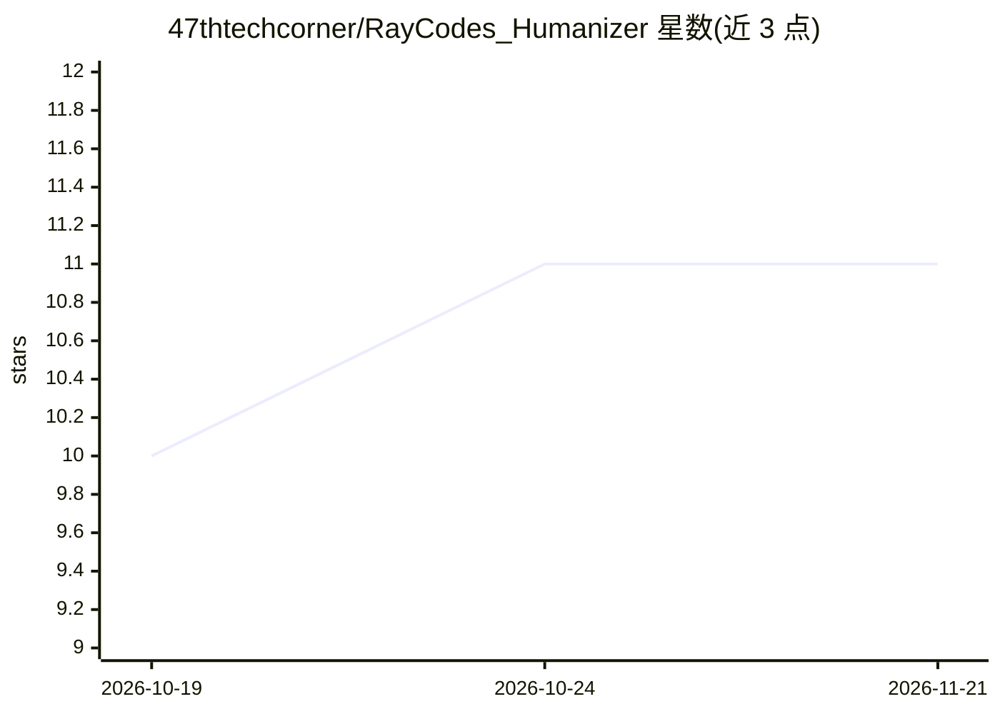

# 47thtechcorner/RayCodes_Humanizer

⭐ 11 · Python · 推送 2026-09-15 · [GitHub](https://github.com/47thtechcorner/RayCodes_Humanizer) · [官网](https://youtu.be/A5Z7XJpZLWI) · 个人维护

**本地运行的人工智能文本人性化处理 skill：将 AI 生成的技术文档改写为开发者博客文体**

以 Agent skill 形式分发的内容转换引擎：读取 `inputs/input_doc.md` 中的 Markdown 文档，调用本地 Ollama 后端（noema2b 或 llama3.2:3b）将密集的 AI 生成技术文档改写为对话式开发者博客，保留代码块、命令行与链接，输出写入 `outputs/outputs.md` 并记录生成时间。提供 `skills` CLI、PowerShell 直接下载、Claude Code 插件三种安装方式；模型需先通过 Ollama 注册。面向需要发布技术文档的开发者与维护者。

## 筛选速览

| 维度 | 判定 | 备注 |
|---|---|---|
| AI 角色 | `ai-native` | 本体是模型或模型工具 |
| 许可风险 | `none` | — |
| 部署形态 | `library` | 以包/库形式分发 |
| 模型依赖 | local-ok | 支持本地模型 |
| 硬件要求 | — | 无带数字的原话,不猜 |
| 安装摩擦 | `low` | 无编译、无系统依赖或容器化 |
| 成熟度 | — | 结构信号不足 |

## 能力要点

- 三种 skill 安装途径：`skills` CLI、PowerShell 下载 SKILL.md、Claude Code 插件
- 本地 Ollama 后端（noema2b / llama3.2:3b），无需云端 API
- 改写时保留代码块、命令行与链接不变
- 输出含生成时间记录的 Markdown 结果文件

## 适用场景

- 清理 AI 起草的 CHANGELOG 和发布说明
- 把架构规格文档改写成团队教程博客
- 去除项目 README 中的机械式措辞
- 将 API 快速入门指南改写为新手友好的流程说明

## 场景标签

`AI 写作` · 领域:内容生成

## 证据(README 行号)

> L8: Humanizer transforms dense, AI-generated technical documentation into clean, conversational developer blog posts. It
> L60: python main.py
> L68: - **Primary AI Backend:** Ollama (`noema2b:latest` / `llama3.2:3b`)

## 星数曲线

2026-10-19 10 → 2026-11-21 11（+1）

---
*卡片 v1 · prompt 1.4 · 生成 2026-11-19 · 置信度 mid · 依据 README sha `8296c62631e8` · [字段定义](../../DATASET.md)*
