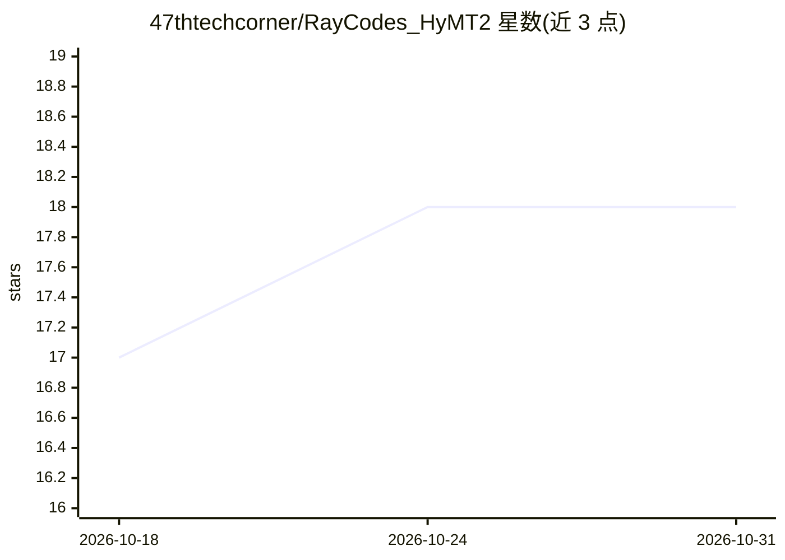

# 47thtechcorner/RayCodes_HyMT2

⭐ 18 · Python · 推送 2026-09-17 · [GitHub](https://github.com/47thtechcorner/RayCodes_HyMT2) · [官网](https://youtu.be/z1E6h2Rc-j0) · 个人维护

**离线 SRT 视频字幕翻译工具：本地 Hy-MT2 模型翻译 33 种语言**

基于 Tencent Hy-MT2 1.8B Q4_K_M GGUF 模型的离线机器翻译工具：读取 inputs/ 目录下的 SRT 视频字幕文件，通过本地 Ollama 运行模型完成翻译，在锁定时间戳与序列格式的前提下输出译文到 outputs/；同时自动生成性能报告 metrics.md。支持 33 种语言，也支持 JSON 与纯文本格式。运行需 Python 3.10+ 与 Ollama，模型权重约 440MB（Q4 量化），需自行从 Hugging Face 下载并用 Modelfile 注册。VTT/ASS 格式与 GUI 界面列为未来计划。

## 筛选速览

| 维度 | 判定 | 备注 |
|---|---|---|
| AI 角色 | `ai-native` | 本体是模型或模型工具 |
| 许可风险 | `none` | — |
| 部署形态 | `None` |  |
| 模型依赖 | local-ok | 支持本地模型 |
| 硬件要求 | `gpu-8g` | |
| 安装摩擦 | `low` | 无编译、无系统依赖或容器化 |
| 成熟度 | — | 结构信号不足 |

## 能力要点

- 翻译 SRT 字幕时保留时间戳边界与序列格式
- 通过 Ollama 本地运行 Hy-MT2 1.8B Q4_K_M GGUF，全程离线
- 支持 33 种语言的批量或指定语言翻译
- 自动生成执行指标报告 outputs/metrics.md

## 适用场景

- 将英文视频字幕离线翻译为其他语言并保持时间轴对齐
- 在无网络或低配置（约 1.15GB 显存/内存）电脑上本地翻译字幕
- 翻译涉及隐私的企业文档或 JSON UI 文案且数据不出本机

## 场景标签

 · 领域:NLP/机器翻译工具

## 证据(README 行号)

> L8: An offline machine translation tool powered by **Tencent Hy-MT2 1.8B Q4_K_M GGUF** that translates video SRT subtitl
> L12: |Load English `.srt` video subtitle file from `inputs/` directory.|Hy-MT2 1.8B GGUF model translates text while loc

## 星数曲线

2026-10-18 17 → 2026-10-31 18（+1）

---
*卡片 v1 · prompt 1.4 · 生成 2026-10-29 · 置信度 high · 依据 README sha `381960584a0d` · [字段定义](../../DATASET.md)*
