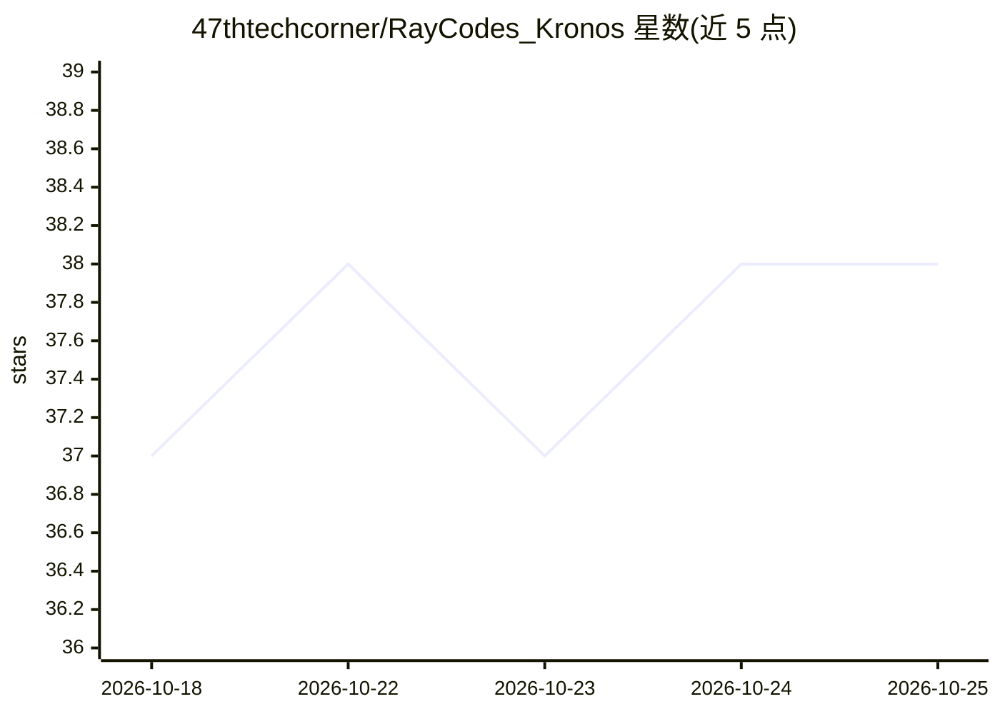

# 47thtechcorner/RayCodes_Kronos

⭐ 39 · Python · 推送 2026-07-28 · [GitHub](https://github.com/47thtechcorner/RayCodes_Kronos) · [官网](https://youtu.be/AdtyZJ7rxsk) · 个人维护

**面向印度散户的 K 线预测与本地 LLM 解读顾问**

基于开源 Kronos-base（约 102.3M 参数、约 400MB 的蜡烛图基础模型）对印度股票与外汇标的生成 14 天 OHLCV 预测和支撑/阻力位，再由本地 Ollama 运行的 Llama 3.2 3B 将量化指标翻译为面向新手的无术语解读；市场数据来自 yfinance 的 NSE 实时行情。主脚本 market_advisor.py 输出 markdown 与 HTML 报告，proof_test.py 对历史 NSE 数据回测方向准确率。以 Python 源码脚本形式提供，需克隆官方 Kronos 仓库并安装依赖。

## 筛选速览

| 维度 | 判定 | 备注 |
|---|---|---|
| AI 角色 | `ai-native` | 本体是模型或模型工具 |
| 许可风险 | `permissive` | — |
| 部署形态 | `library` | 以包/库形式分发 |
| 模型依赖 | local-ok | 支持本地模型 |
| 硬件要求 | — | 无带数字的原话,不猜 |
| 安装摩擦 | `low` | 无编译、无系统依赖或容器化 |
| 成熟度 | — | 结构信号不足 |

## 能力要点

- Kronos-base 分层 K 线 tokenization 预测未来 OHLCV 路径
- 本地 Ollama Llama 3.2 3B 生成新手友好的解读报告
- proof_test.py 对 NSE 历史数据回测方向准确率
- 生成暗色玻璃拟态交互 HTML 报告与 markdown 导出

## 适用场景

- 查看 NIFTY 50、Reliance、HDFC Bank 等标的的 14 天预测与买卖位
- 以通俗类比理解量化预测结果，无需掌握技术指标
- 用回测脚本验证模型方向性可靠性
- 监控黄金 ETF 与 USD/INR 汇率路径辅助对冲决策

## 场景标签

`金融量化` · 领域:学习与行业

## 证据(README 行号)

> L13: An advanced, AI-driven quantitative prediction and interpretation system designed specifically for Indian financial
> L17: * **Kronos Foundation Model**: Utilizes the 102.3M parameter (`~400MB`) base model with hierarchical K-line tokeniz
> L18: * **Beginner-Friendly Interpretation**: Local Ollama AI analyzes quantitative forecasting metrics and translates th

## 星数曲线

2026-10-18 37 → 2026-10-25 38（+1）

---
*卡片 v1 · prompt 1.4 · 生成 2026-10-25 · 置信度 mid · 依据 README sha `316a37db8894` · [字段定义](../../DATASET.md)*
