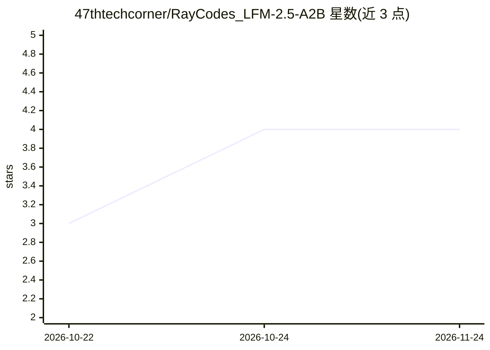

# 47thtechcorner/RayCodes_LFM-2.5-A2B

⭐ 4 · 推送 2026-10-14 · [GitHub](https://github.com/47thtechcorner/RayCodes_LFM-2.5-A2B) · [官网](https://youtu.be/Vly9ZtikKFU) · 个人维护

**面向本地部署者运行 LFM2.5-24B 模型的教程与测试提示集**

围绕 Liquid AI 的 LFM2.5-24B-A2B 混合架构模型整理的本地运行指南：介绍其卷积层+GQA+64 专家 MoE 的架构参数、各量化格式的显存/内存需求表，给出 llama.cpp 命令行与 vLLM OpenAI 兼容服务两种本地运行命令，并提供 6 条零依赖测试提示词用于在 playground 或本地验证空间推理、代码生成与算法追踪能力。面向在消费级硬件上本地部署与测试该模型的开发者。内容以教程与资源链接为主，仓库本身无可安装组件。

## 筛选速览

| 维度 | 判定 | 备注 |
|---|---|---|
| AI 角色 | `ai-knowledge` | 知识聚合/清单类 |
| 许可风险 | `none` | — |
| 部署形态 | `None` |  |
| 模型依赖 | local-ok | 支持本地模型 |
| 硬件要求 | `gpu-24g` | |
| 安装摩擦 | `low` | 无编译、无系统依赖或容器化 |
| 成熟度 | — | 结构信号不足 |

## 能力要点

- 整理各量化格式（FP16/QAD-Q4_0/Q4_K_M 等）对应的最低显存/内存需求表
- 提供 llama.cpp CLI 与 vLLM OpenAI 兼容服务两种本地运行命令
- 提供 6 条零依赖测试提示词，覆盖空间推理、代码生成、算法状态追踪
- 汇总 HuggingFace/GGUF/Playground/文档等官方链接

## 适用场景

- 在消费级 GPU 或 CPU 上本地运行 LFM2.5-24B-A2B
- 选择匹配自身硬件的量化版本
- 用现成提示词测试模型推理与代码生成能力

## 场景标签

`教程课程` · 领域:学习与行业

## 证据(README 行号)

> L6: # ⚡ Liquid LFM2.5-24B-A2B: Edge Reasoning Revolution
> L126: ## 🛠️ How to Run LFM2.5-24B Locally
> L63: ## 🧪 6 Zero-Dependency Prompts to Test on playground.liquid.ai

## 星数曲线

2026-10-22 3 → 2026-11-24 4（+1）

---
*卡片 v1 · prompt 1.4 · 生成 2026-11-21 · 置信度 high · 依据 README sha `f564b85e2065` · [字段定义](../../DATASET.md)*
