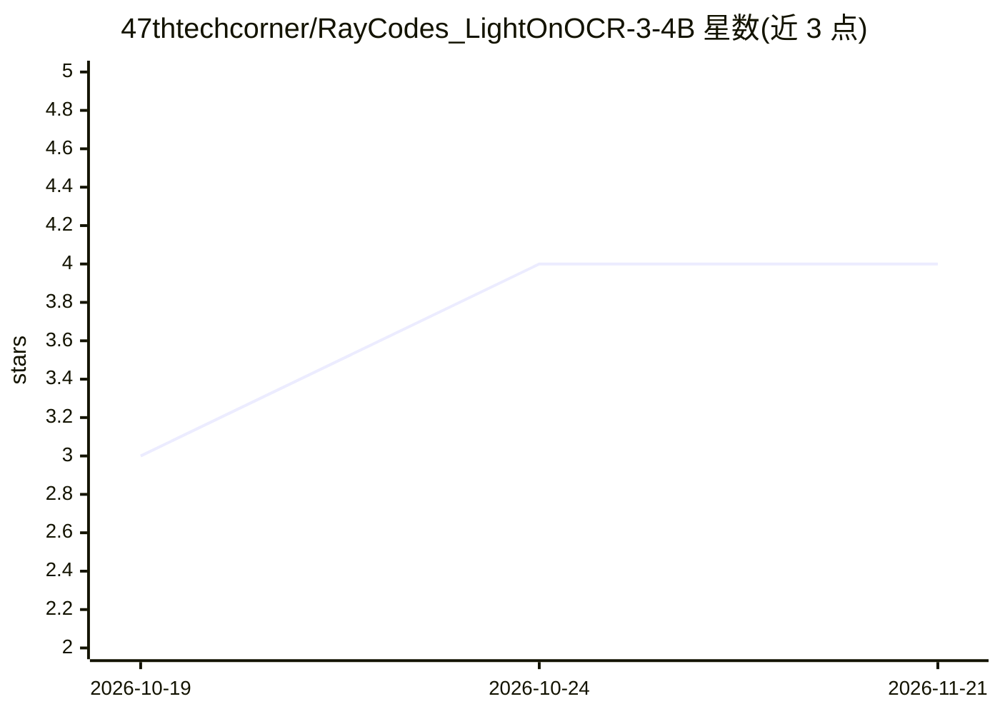

# 47thtechcorner/RayCodes_LightOnOCR-3-4B

⭐ 4 · Python · 推送 2026-10-11 · [GitHub](https://github.com/47thtechcorner/RayCodes_LightOnOCR-3-4B) · [官网](https://youtu.be/5uZurgx1Drs) · 个人维护

**本地 OCR 流水线：单模型提取页面文本、版面坐标与图表表格**

基于 LightOnOCR-3（4B 参数 Qwen3.5 视觉架构）的文档理解流水线：输入单页图片或 400 DPI 渲染的 PDF，模型一步输出阅读顺序文本、带标签的边界框坐标和结构化表格；图表自动识别并转为 HTML 表格。提供两种运行模式：空提示输出纯文本，"grounding" 提示输出空间坐标。经 4-bit GGUF 量化部署在本地 Ollama，附 Python 脚本（main.py）与 Modelfile 注册流程。面向需要离线文档数字化的用户。

## 筛选速览

| 维度 | 判定 | 备注 |
|---|---|---|
| AI 角色 | `ai-native` | 本体是模型或模型工具 |
| 许可风险 | `none` | — |
| 部署形态 | `library` | 以包/库形式分发 |
| 模型依赖 | local-ok | 支持本地模型 |
| 硬件要求 | — | 无带数字的原话,不猜 |
| 安装摩擦 | `low` | 无编译、无系统依赖或容器化 |
| 成熟度 | — | 结构信号不足 |

## 能力要点

- 单模型完成版面检测、文本转录与表格重建
- 空提示/grounding 双模式：纯文本或空间边界框输出
- 图表自动转 HTML 表格（科学与金融图表）
- 4-bit GGUF 本地部署，通过 Ollama 运行

## 适用场景

- 把财报和资产负债表图表转成结构化表格
- 数字化手写处方与化验单并保留坐标
- 法律合同多栏版面提取，供 RAG 引用
- 发票收据的行项目与税额表格自动提取

## 场景标签

`OCR` `文档解析` · 领域:知识与检索

## 证据(README 行号)

> L8: > High-accuracy document understanding model that extracts full page text, spatial layout bounding coordinates, and 
> L13: |**Step 2**|AI Action|LightOnOCR-3 processes visual tokens with native grounding detection|
> L21: * ⚡ **Open Weights & Local Deployment**: 4B parameter Qwen3.5 vision architecture ready for local inference via 4-b

## 星数曲线

2026-10-19 3 → 2026-11-21 4（+1）

---
*卡片 v1 · prompt 1.4 · 生成 2026-11-21 · 置信度 high · 依据 README sha `565501e63d59` · [字段定义](../../DATASET.md)*
