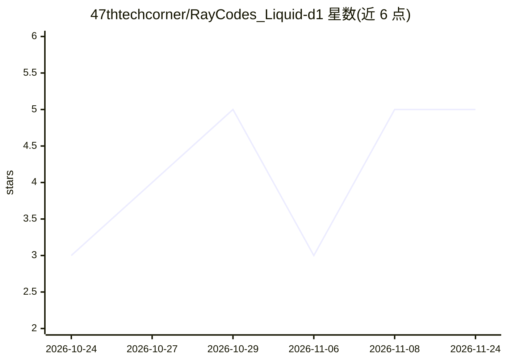

# 47thtechcorner/RayCodes_Liquid-d1

⭐ 5 · Python · 推送 2026-10-15 · [GitHub](https://github.com/47thtechcorner/RayCodes_Liquid-d1) · [官网](https://youtu.be/dS-Q47dI2_M) · 个人维护

**面向客服理赔的多模态零token分诊引擎，同步评估文本与照片**

基于 Liquid AI d1-omni 模型（600M/3B）构建的客户投诉分诊管线：将客户文本消息与损坏物品照片输入单次前向传播，输出路由决策（换货/易碎品理赔/安全升级）、严重度评估与真伪筛查的 JSON 结果，不经自回归文本流生成，逐请求记录毫秒级延迟。运行需下载 8-bit GGUF 权重与视觉投影器，通过 Ollama 注册 Modelfile 或 llama-server 启动服务，Python 脚本批量评估 5 个样例并导出结果文件。

## 筛选速览

| 维度 | 判定 | 备注 |
|---|---|---|
| AI 角色 | `ai-native` | 本体是模型或模型工具 |
| 许可风险 | `none` | — |
| 部署形态 | `library` | 以包/库形式分发 |
| 模型依赖 | local-ok | 支持本地模型 |
| 硬件要求 | — | 无带数字的原话,不猜 |
| 安装摩擦 | `low` | 无编译、无系统依赖或容器化 |
| 成熟度 | — | 结构信号不足 |

## 能力要点

- 文本与照片单次前向传播同步输出路由、严重度与真伪判定
- 零 token 架构：不经自回归文本流生成直接给出决策
- 提供 Ollama Modelfile 注册与 llama-server 两种运行方式
- 逐请求记录执行延迟，面向高吞吐队列

## 适用场景

- 电商退货理赔中自动核验商品破损照片
- 行李损坏理赔的快速分诊与补偿路由
-  cracked 电器等危险品的自动升级筛查
- 物流包装破损与实物不符的理赔核验

## 场景标签

`多模态` · 领域:感知与多模态

## 证据(README 行号)

> L8: Liquid d1 Multimodal Support Triage is a zero-token decision engine that analyzes customer complaint text and damage
> L26: - **Model:** Liquid AI d1-omni-600M / d1-3B
> L28: - **GGUF Runtime:** llama.cpp / Ollama (`llama-server`) with `mmproj-model-f16.gguf`

## 星数曲线

2026-10-24 3 → 2026-11-24 5（+2）

---
*卡片 v1 · prompt 1.4 · 生成 2026-11-21 · 置信度 high · 依据 README sha `210dd25f7be4` · [字段定义](../../DATASET.md)*
