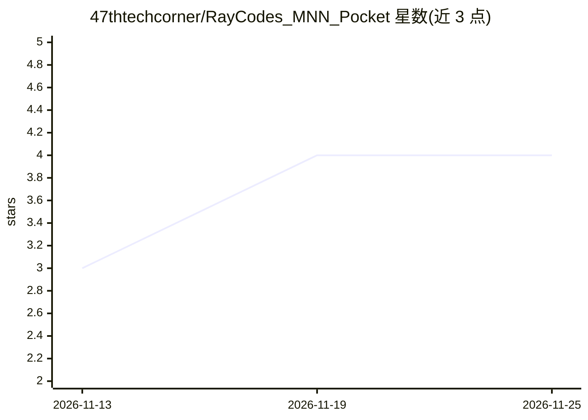

# 47thtechcorner/RayCodes_MNN_Pocket

⭐ 4 · HTML · 推送 2026-11-12 · [GitHub](https://github.com/47thtechcorner/RayCodes_MNN_Pocket) · [官网](https://youtu.be/TOWUUAqOi9E) · 个人维护

**为移动/边缘设备提供的 173MB 本地语言模型与运行管线**

基于阿里巴巴 Taobao 与 MNN 推理引擎协同设计的 173MB 端侧语言 transformer（INT4 量化、Apache 2.0 许可），在手机、平板、笔记本上离线运行。README 给出 Windows PowerShell 快速开始流程：创建虚拟环境、pip 安装依赖、下载权重并注册运行时，随后运行 main.py 生产管线；附三个测试工作流（意图路由、收据规范化、语音指令控制）与四个应用场景说明。仅提供源码运行方式，移动端原生包列在路线图中尚未提供。

## 筛选速览

| 维度 | 判定 | 备注 |
|---|---|---|
| AI 角色 | `ai-native` | 本体是模型或模型工具 |
| 许可风险 | `permissive` | — |
| 部署形态 | `library` | 以包/库形式分发 |
| 模型依赖 | local-ok | 支持本地模型 |
| 硬件要求 | — | 无带数字的原话,不猜 |
| 安装摩擦 | `low` | 无编译、无系统依赖或容器化 |
| 成熟度 | — | 结构信号不足 |

## 能力要点

- 173MB INT4 量化端侧模型，与 MNN 推理引擎协同设计，离线运行
- 三个生产测试工作流：意图路由、交易短信解析、语音硬件控制
- 声明 350 tok/s 吞吐与亚毫秒级速度
- 路线图包含 MNN C++ 移动运行时与 whisper.cpp 语音管线集成

## 适用场景

- 在手机上离线路由自然语言指令到原生设置、相机和导航
- 在本地内存中解析交易短信和银行提醒做财务审计
- 给智能手表和 IoT 传感器提供本地语音指令解释
- 为移动游戏嵌入低内存开销的离线 NPC 对话

## 场景标签

`推理引擎` `模型量化` · 领域:训练与推理

## 证据(README 行号)

> L14: > Alibaba Taobao's 173MB on-device language transformer co-designed with the MNN inference engine to run natively o
> L20: |**Smart App-State Intent Router**|Sub-millisecond categorical intent routing and execution path dispatching|Multil

## 星数曲线

2026-11-13 3 → 2026-11-25 4（+1）

---
*卡片 v1 · prompt 1.4 · 生成 2026-11-21 · 置信度 mid · 依据 README sha `1057ff5668a1` · [字段定义](../../DATASET.md)*
