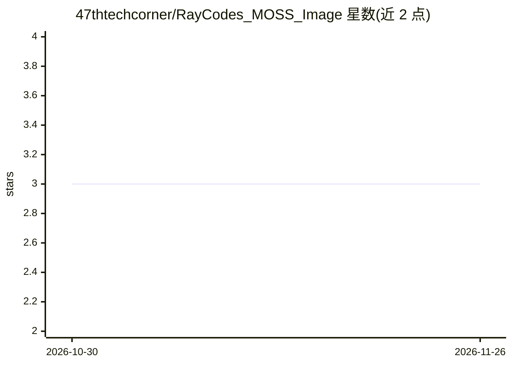

# 47thtechcorner/RayCodes_MOSS_Image

⭐ 3 · Python · 推送 2026-10-19 · [GitHub](https://github.com/47thtechcorner/RayCodes_MOSS_Image) · [官网](https://youtu.be/MuwWxCOufQ8) · 个人维护

**本地生成商业产品广告图的 AI 工作流工具**

基于 OpenMOSS 5B DiT 模型与 8-step DMD 加速 LoRA 的端到端产品广告图生成工具：用户输入产品名、瓶型与品牌标语后，自动生成 JSON 空间边界框布局，经 8 步流匹配推理输出 5 张 4K 广告场景图（含标签排版）。提供 Windows PowerShell 的 git clone + venv 安装路径、直接 Python 运行与独立 Diffusers pipeline 两种运行方式。要求 Python 3.10+、PyTorch 2.5+ CUDA、8-16GB VRAM；ComfyUI 自定义节点尚属规划功能。

## 筛选速览

| 维度 | 判定 | 备注 |
|---|---|---|
| AI 角色 | `ai-native` | 本体是模型或模型工具 |
| 许可风险 | `permissive` | — |
| 部署形态 | `library` | 以包/库形式分发 |
| 模型依赖 | — | README 未给出锁定关系 |
| 硬件要求 | `gpu-8g` | |
| 安装摩擦 | `medium` | 含编译或系统依赖之一 |
| 成熟度 | — | 结构信号不足 |

## 能力要点

- 8-step DMD 加速推理，4070S 上单次约 5 秒生成 5 张 4K 广告图
- 自动生成 JSON 空间边界框与居中排版坐标
- 支持低显存 CPU offload 运行方式
- 提供独立 Diffusers pipeline 调用示例

## 适用场景

- 为一个产品批量生成多种场景的品牌广告图
- 制作电商 Shopify/Amazon 轮播主图
- 下单实物瓶前预览包装标签排版效果
- 为 TikTok/Meta 广告导出不同风格的 A/B 测试素材

## 场景标签

`图像生成` · 领域:内容生成

## 证据(README 行号)

> L12: An end-to-end commercial product advertising studio powered by **OpenMOSS's 5B Diffusion Transformer (DiT)** and **
> L20: |**3. 8-Step DMD DiT**|Fast 8-step flow-matching inference (5s on 4070S)|5 commercial 4K campaign ads|
> L65: 1. **Brand Ad Campaign Matrix**: Generate 5 diverse photo environments (studio, macro splash, sunset vanity, obsidi

## 星数曲线

2026-10-30 3 → 2026-11-26 3（+0）

---
*卡片 v1 · prompt 1.4 · 生成 2026-11-26 · 置信度 high · 依据 README sha `f2c0ccd10636` · [字段定义](../../DATASET.md)*
