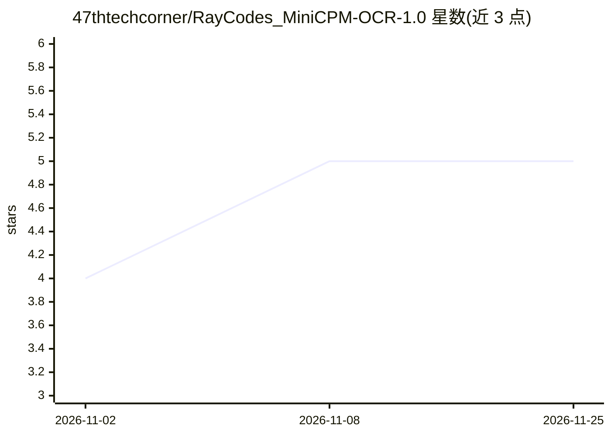

# 47thtechcorner/RayCodes_MiniCPM-OCR-1.0

⭐ 5 · Python · 推送 2026-10-29 · [GitHub](https://github.com/47thtechcorner/RayCodes_MiniCPM-OCR-1.0) · [官网](https://youtu.be/g-bPSGuClr0) · 个人维护

**面向文档 OCR 场景的 MiniCPM-OCR 1.0 本地推理测试管线**

围绕 OpenBMB 发布的 MiniCPM-OCR 1.0（1.3B，Apache 2.0）构建的本地 OCR 推理管线，使用 Ollama 运行 GGUF 权重，读取收据、学术推导、双栏论文等扫描件，生成结构化报告、LaTeX 公式与 Markdown 文档。README 提供三个 Windows PowerShell 测试工作流及引用行，附的未来路线图（Jev 2B 质控循环、vLLM/TensorRT-LLM 批处理、RAG 分块索引）为规划项，尚未实现。引用行数据来自模型官方描述，非作者实测。

## 筛选速览

| 维度 | 判定 | 备注 |
|---|---|---|
| AI 角色 | `ai-native` | 本体是模型或模型工具 |
| 许可风险 | `permissive` | — |
| 部署形态 | `library` | 以包/库形式分发 |
| 模型依赖 | local-ok | 支持本地模型 |
| 硬件要求 | — | 无带数字的原话,不猜 |
| 安装摩擦 | `low` | 无编译、无系统依赖或容器化 |
| 成熟度 | — | 结构信号不足 |

## 能力要点

- 本地运行 MiniCPM-OCR 1.0（1.3B，约 1.7GB 占用）进行文档 OCR
- 三个测试工作流：财务收据 KIE 抽取、公式转 LaTeX、双栏论文转 Markdown
- 基于 Ollama + GGUF 的本地推理，含 python 脚本安装与运行步骤

## 适用场景

- 把收据和供应商账单数字化成结构化财务报告
- 将物理/工程论文扫描页转成可编译的 LaTeX 文档
- 低配设备离线批量录入文档，不经云端处理

## 场景标签

`OCR` · 领域:感知与多模态

## 证据(README 行号)

> L15: ## 📊 Production Test Workflows
> L36: ```powershell

## 星数曲线



2026-11-02 4 → 2026-11-25 5（+1）


---
*卡片 v1 · prompt 1.4 · 生成 2026-11-21 · 置信度 high · 依据 README sha `6bb14da0ed77` · [字段定义](../../DATASET.md)*
