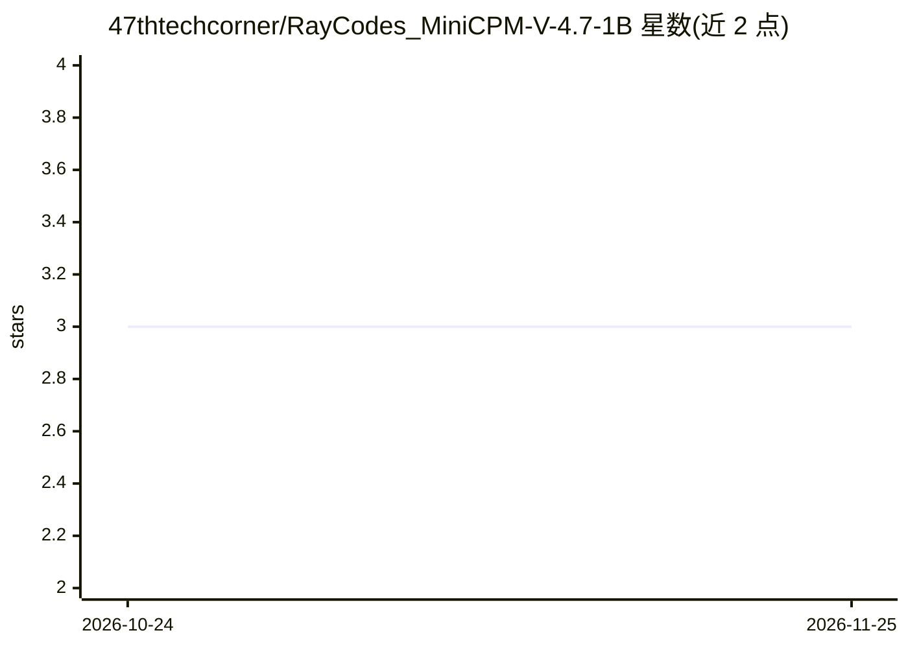

# 47thtechcorner/RayCodes_MiniCPM-V-4.7-1B

⭐ 3 · Python · 推送 2026-10-13 · [GitHub](https://github.com/47thtechcorner/RayCodes_MiniCPM-V-4.7-1B) · [官网](https://youtu.be/SQg5L6f50Bs) · 个人维护

**基于 MiniCPM-V 4.7 1B 的离线多模态图像分析工具**

通过 Ollama 本地运行 OpenBMB MiniCPM-V 4.7 (1B) Q8_0 GGUF 模型的离线视觉分析管线：读取本地收据、图表、多张照片，生成结构化 Markdown 表格、OCR 字段与延迟基准。功能覆盖收据 OCR 条目化、科学图表推理、多图场景对比、CPU 上的 time-to-first-token 与吞吐测速。安装流程为 pip 依赖、hf 下载权重、Ollama Modelfile 注册、python main.py 运行。

## 筛选速览

| 维度 | 判定 | 备注 |
|---|---|---|
| AI 角色 | `ai-native` | 本体是模型或模型工具 |
| 许可风险 | `none` | — |
| 部署形态 | `library` | 以包/库形式分发 |
| 模型依赖 | local-ok | 支持本地模型 |
| 硬件要求 | — | 无带数字的原话,不猜 |
| 安装摩擦 | `low` | 无编译、无系统依赖或容器化 |
| 成熟度 | — | 结构信号不足 |

## 能力要点

- 收据 OCR 解析为结构化 JSON 与 Markdown 表格（含总额与税率）
- 科学图表与基准曲线解读（入射角计算、Pareto 效率判断）
- 多图并列对比检测物体变化与空间转换
- 消费级 CPU 上直接测量 TTFT 与吞吐延迟

## 适用场景

- 把纸质收据条目导出到记账软件做费用核算
- 现场巡检笔记本无网环境下运行 1.06 GB 模型做诊断
- 对比流水线装配照片发现缺陷与错位
- 将财务图表转成摘要要点报告

## 场景标签

`多模态` `文档解析` · 领域:知识与检索

## 证据(README 行号)

> L8: High-speed offline multimodal visual analysis workstation powered by the ultra-compact MiniCPM-V 4.7 1B on-device vi
> L24: - **Model:** OpenBMB MiniCPM-V 4.7 (1B Q8_0 GGUF / Ollama Model)
> L71: python main.py

## 星数曲线

2026-10-24 3 → 2026-11-25 3（+0）

---
*卡片 v1 · prompt 1.4 · 生成 2026-11-22 · 置信度 high · 依据 README sha `2471ef4c7b5d` · [字段定义](../../DATASET.md)*
