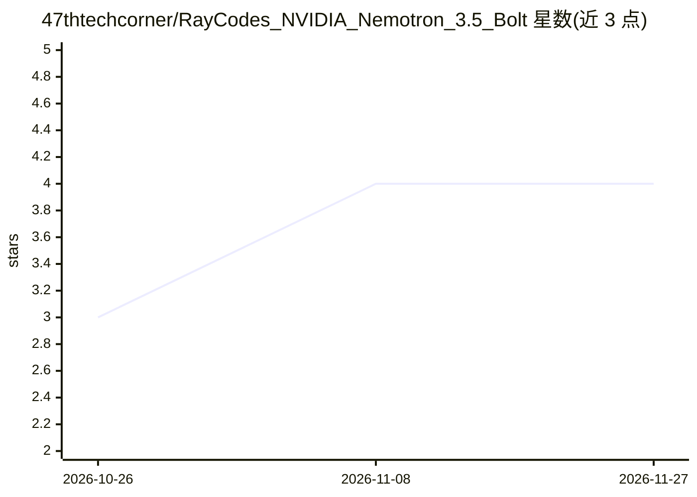

# 47thtechcorner/RayCodes_NVIDIA_Nemotron_3.5_Bolt

⭐ 4 · Python · 推送 2026-10-24 · [GitHub](https://github.com/47thtechcorner/RayCodes_NVIDIA_Nemotron_3.5_Bolt) · [官网](https://youtu.be/nFHkXVVup5Y) · 个人维护

**4GB 显存本地运行的桌面 AI Agent 流水线（NVIDIA Nemotron 3.5 Bolt）**

围绕 NVIDIA Nemotron 3.5 Bolt E4B 模型（8B/4B 激活，2-bit 量化，4GB VRAM）构建的本地桌面 Agent 流水线：提供三个示例工作流——桌面文件整理、日程规划、报销单提取，均以模型原生异步工具调用执行本地动作。通过 Ollama 加载 GGUF 权重运行，README 附 Windows PowerShell 安装步骤与 main.py 入口；声明的限制为依赖本地消费级 GPU 显存。

## 筛选速览

| 维度 | 判定 | 备注 |
|---|---|---|
| AI 角色 | `ai-native` | 本体是模型或模型工具 |
| 许可风险 | `none` | — |
| 部署形态 | `library` | 以包/库形式分发 |
| 模型依赖 | local-ok | 支持本地模型 |
| 硬件要求 | `gpu-8g` | |
| 安装摩擦 | `low` | 无编译、无系统依赖或容器化 |
| 成熟度 | — | 结构信号不足 |

## 能力要点

- 模型原生异步工具调用与 64K 上下文窗口
- 三个可运行工作流：文件整理/日程助手/报销提取
- 2-bit 量化后占用 4GB VRAM 本地运行
- 通过 Ollama 加载 GGUF 模型文件

## 适用场景

- 在消费级 PC 上离线整理杂乱文件目录
- 本地解析收据并生成费用台账
- 构建不冻结界面的本地语音助手
- 驱动遵守规则、记忆任务历史的游戏 NPC

## 场景标签

`工作流自动化` · 领域:效率与自动化

## 证据(README 行号)

> L13: > *"Nemotron 3.5 Bolt E4B delivers high-speed, local multi-turn conversational agents with native asynchronous tool
> L19: |**Local Desktop File Organizer**|📂 Native Tool Execution & Safety|Authentic file directory with unorganized files 
> L30: ollama create nemotron-3.5-bolt:2b-iq2 -f Modelfile

## 星数曲线

2026-10-26 3 → 2026-11-27 4（+1）

---
*卡片 v1 · prompt 1.4 · 生成 2026-11-21 · 置信度 high · 依据 README sha `ac3138f753ae` · [字段定义](../../DATASET.md)*
