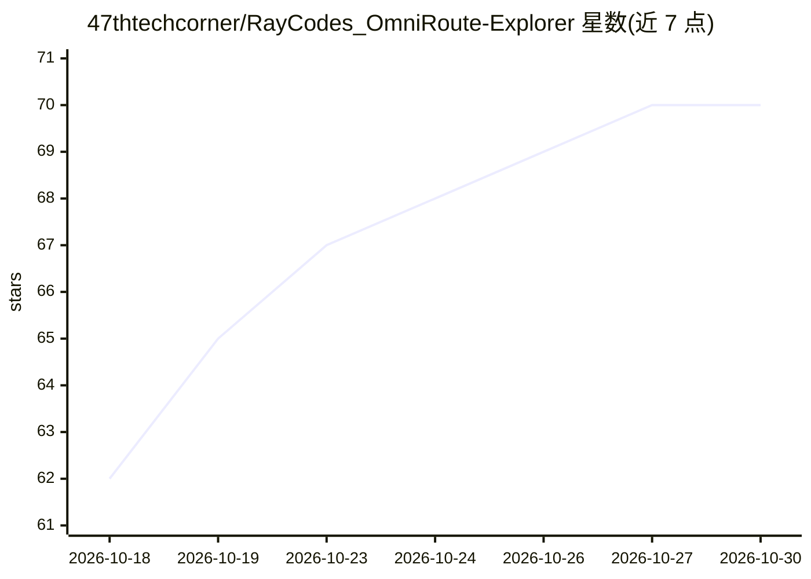

# 47thtechcorner/RayCodes_OmniRoute-Explorer

⭐ 70 · Python · 推送 2026-07-03 · [GitHub](https://github.com/47thtechcorner/RayCodes_OmniRoute-Explorer) · [官网](https://youtu.be/If7Xeozh17Q) · 个人维护

**基于 OmniRoute 网关的 Streamlit AI 仪表盘与报告生成工具**

一个 Python/Streamlit 轻量应用，通过 OmniRoute（AI 网关）的 OpenAI 兼容 /v1 端点连接 237+ AI 提供商：app.py 提供交互式聊天界面，generate_report.py 命令行生成 Markdown 格式报告，可接入 CI/CD 流程做自动代码评审。依赖仅 openai 与 streamlit；网关本体需另行 npm 安装。面向希望以单一端点统一调用多模型并利用 OmniRoute 压缩节省 token 的开发者；多模型对比视图、文档解析等仍列为未来功能。

## 筛选速览

| 维度 | 判定 | 备注 |
|---|---|---|
| AI 角色 | `ai-native` | 本体是模型或模型工具 |
| 许可风险 | `none` | — |
| 部署形态 | `library` | 以包/库形式分发 |
| 模型依赖 | — | README 未给出锁定关系 |
| 硬件要求 | — | 无带数字的原话,不猜 |
| 安装摩擦 | `low` | 无编译、无系统依赖或容器化 |
| 成熟度 | — | 结构信号不足 |

## 能力要点

- 通过 OmniRoute 单一端点连接 237+ AI 提供商
- Streamlit 交互式聊天界面（app.py）
- 命令行生成 Markdown 报告（generate_report.py），可嵌入 CI/CD
- 使用 OpenAI SDK 与 OmniRoute 的 OpenAI 兼容 /v1 端点通信

## 适用场景

- 用同一提示对不同模型做统一测试与基准对比
- 在 CI/CD 流水线中自动生成 Markdown 格式的 PR 评审报告
- 在本地通过 localhost 端点开发与聊天，不依赖云端延迟

## 场景标签

`代码审查` `模型评测` · 领域:编码与开发

## 证据(README 行号)

> L12: **A lightweight, unified dashboard and reporting tool powered by OmniRoute — The Free AI Gateway.**
> L49: - `app.py`: The visual Streamlit dashboard for interactive OmniRoute querying.
> L50: - `generate_report.py`: A command-line script that queries OmniRoute to generate a formatted Markdown report.

## 星数曲线

2026-10-18 62 → 2026-10-30 70（+8）

---
*卡片 v1 · prompt 1.4 · 生成 2026-10-24 · 置信度 mid · 依据 README sha `1824bcd7c0fc` · [字段定义](../../DATASET.md)*
