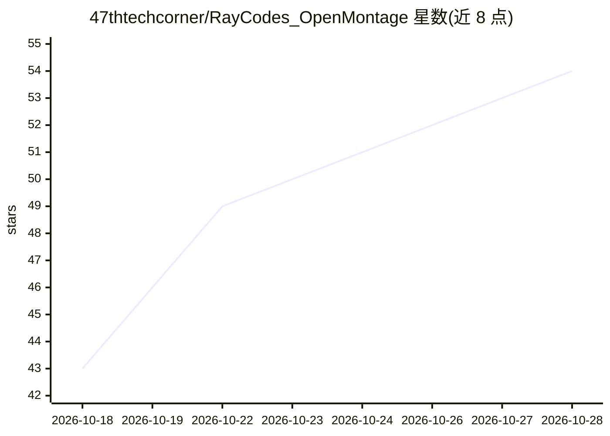

# 47thtechcorner/RayCodes_OpenMontage

⭐ 54 · Python · 推送 2026-06-22 · [GitHub](https://github.com/47thtechcorner/RayCodes_OpenMontage) · [官网](https://youtu.be/FyM-0sJYIR8) · 个人维护

**本地 AI 视频生成系统：用 Ollama 与 FFmpeg 自动剪辑成片**

基于 Ollama 本地多模态模型与 FFmpeg 的开源视频制作管线：解析用户提示词生成结构化 production_plan.json，通过 HyperFrames 时间线引擎（HTML/CSS/GSAP + Chrome Headless Shell 渲染）合成动态字幕、车道向量与目标检测框等叠加图层，再由 FFmpeg 自动裁剪、缩放、调色并套用暗角/对比度滤镜，最终输出 MP4。以 Streamlit 网页仪表盘交互运行，需 Python 3.10+、Node.js ≥22、FFmpeg 与 Ollama 环境，全程无外部 API 依赖。核心引擎模块各控制在 100 行以内。

## 筛选速览

| 维度 | 判定 | 备注 |
|---|---|---|
| AI 角色 | `ai-native` | 本体是模型或模型工具 |
| 许可风险 | `none` | — |
| 部署形态 | `library` | 以包/库形式分发 |
| 模型依赖 | local-ok | 支持本地模型 |
| 硬件要求 | — | 无带数字的原话,不猜 |
| 安装摩擦 | `medium` | 含编译或系统依赖之一 |
| 成熟度 | — | 结构信号不足 |

## 能力要点

- 本地多模态模型（gemma4:e2b）生成制作计划与场景布局，无外部 API 依赖
- HyperFrames 引擎用 HTML/CSS/GSAP 渲染字幕与动态图形叠加
- FFmpeg 自动裁剪、调色与暗角/对比度滤镜
- Streamlit 仪表盘交互式生成视频，核心模块各少于 100 行

## 适用场景

- 在本地把短视频素材自动加工成带字幕和特效的成片
- 不用云端 API、仅靠本地模型完成视频脚本与剪辑计划
- 通过网页提示词一键驱动从计划生成到 MP4 渲染的完整管线

## 场景标签

`视频生成` · 领域:内容生成

## 证据(README 行号)

> L8: **Automated Local Video Editing and Generation Pipeline powered by Ollama and FFmpeg.**
> L12: OpenMontage is a professional, open-source local video production system. It combines local LLM reasoning with adva
> L79: - Parse your prompt and generate/load the structured `production_plan.json`.

## 星数曲线

2026-10-18 43 → 2026-10-28 54（+11）

---
*卡片 v1 · prompt 1.4 · 生成 2026-10-24 · 置信度 mid · 依据 README sha `c67196d60229` · [字段定义](../../DATASET.md)*
