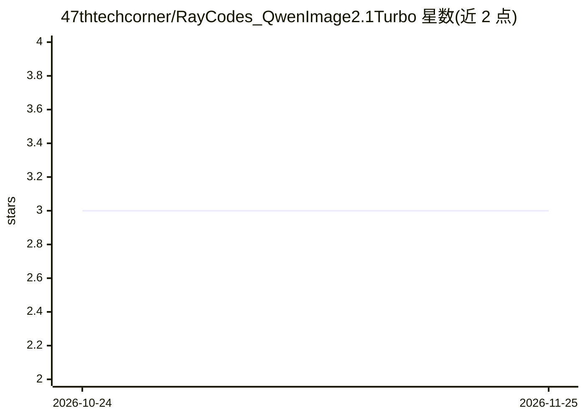

# 47thtechcorner/RayCodes_QwenImage2.1Turbo

⭐ 3 · Python · 推送 2026-10-10 · [GitHub](https://github.com/47thtechcorner/RayCodes_QwenImage2.1Turbo) · [官网](https://youtu.be/cdTB3TgD6OI) · 个人维护

**为视频创作者本地生成 4 变体 YouTube 封面的工具**

基于 Python 的缩略图生成工具：读取视频快照与主题描述，经 Qwen-Image-2.1-Turbo 扩散管线（8 步去噪）生成四个封面变体，由本地 Ollama 生成病毒式标题钩子，Pillow 负责排版与四宫格拼合，输出可用于 A/B 测试的网格图。安装需 pip 装依赖并用 hf CLI 下载约 3GB 的模型权重到本地 models/ 目录，本地 GPU 运行。

## 筛选速览

| 维度 | 判定 | 备注 |
|---|---|---|
| AI 角色 | `ai-native` | 本体是模型或模型工具 |
| 许可风险 | `none` | — |
| 部署形态 | `library` | 以包/库形式分发 |
| 模型依赖 | local-ok | 支持本地模型 |
| 硬件要求 | — | 无带数字的原话,不猜 |
| 安装摩擦 | `low` | 无编译、无系统依赖或容器化 |
| 成熟度 | — | 结构信号不足 |

## 能力要点

- 8 步去噪扩散生成四个封面变体网格
- 本地 Ollama 生成 viral hook 文本
- Pillow 自动排版与四宫格拼合
- 宣称可在消费级 GPU 低显存环境本地运行

## 适用场景

- 同时测试 4 种封面视觉方案选出点击率最高的
- 从播客录像生成引言卡片与章节封面
- 为 X 和 LinkedIn 生成横版与方形预览图
- 为课程视频生成章节封面横幅

## 场景标签

`图像生成` · 领域:内容生成

## 证据(README 行号)

> L13: An AI thumbnail creator that turns raw video frames into four distinct high-CTR thumbnail variations with automated
> L55: |**Hook Engine**|Local Ollama|Fast prompt engineering and viral text hook creation|

## 星数曲线

2026-10-24 3 → 2026-11-25 3（+0）

---
*卡片 v1 · prompt 1.4 · 生成 2026-11-22 · 置信度 high · 依据 README sha `427d7252f7d3` · [字段定义](../../DATASET.md)*
