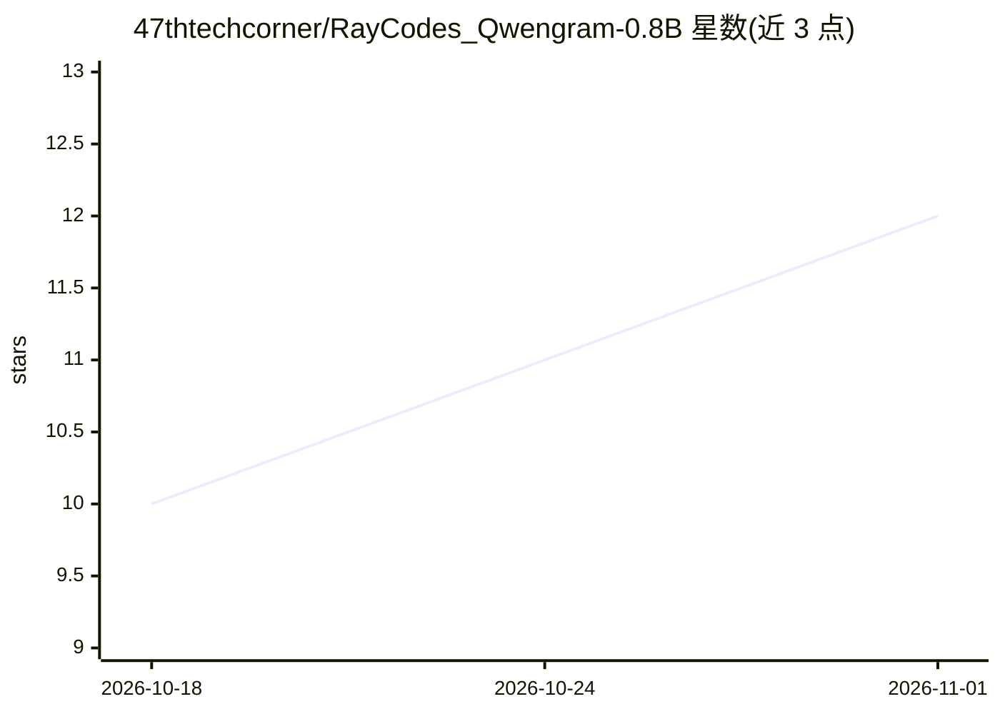

# 47thtechcorner/RayCodes_Qwengram-0.8B

⭐ 12 · Python · 推送 2026-09-26 · [GitHub](https://github.com/47thtechcorner/RayCodes_Qwengram-0.8B) · 个人维护

**0.8B 本地 LLM 运行引擎：Qwengram N-gram 记忆迁移模型**

提供 Qwengram-0.8B（GGUF 格式）的端到端 Python 引擎：从 Qwen3.8 Flash-Next 迁移 N-gram 记忆模式到 0.8B 基座模型，README 称文本生成错误率降低 5.05%。运行 python main.py 处理文本提示或文件查询，将动态输出与性能指标写入 outputs/outputs.md。可通过 pip 安装依赖并经 hf 下载模型，支持（可选）用 Ollama 注册本地模型镜像提供服务。仓库含 Modelfile、requirements.txt 与 main.py。规划中的量化变体、交互式 CLI、Web 面板等功能尚未实现。

## 筛选速览

| 维度 | 判定 | 备注 |
|---|---|---|
| AI 角色 | `ai-native` | 本体是模型或模型工具 |
| 许可风险 | `none` | — |
| 部署形态 | `library` | 以包/库形式分发 |
| 模型依赖 | local-ok | 支持本地模型 |
| 硬件要求 | — | 无带数字的原话,不猜 |
| 安装摩擦 | `low` | 无编译、无系统依赖或容器化 |
| 成熟度 | — | 结构信号不足 |

## 能力要点

- N-gram 记忆模式从 Qwen3.8 Flash-Next 迁移到 0.8B 基座
- GGUF 格式模型，pip 安装依赖 + hf 下载权重
- 可选经 ollama create 注册为本地 Ollama 模型
- 输出与性能指标自动写入 outputs/outputs.md

## 适用场景

- 在树莓派等离线边缘设备上跑轻量文本生成
- 本地解析敏感 JSON/CSV/文本文件，不外发云端
- 本地小模型生成摘要或游戏 NPC 对话

## 场景标签

`推理引擎` · 领域:训练与推理

## 证据(README 行号)

> L13: Qwengram 0.8B transfers recall memory patterns from Qwen3.8 Flash-Next into a lightweight 0.8B base model, lowering
> L42: python main.py

## 星数曲线

2026-10-18 10 → 2026-11-01 12（+2）

---
*卡片 v1 · prompt 1.4 · 生成 2026-11-01 · 置信度 mid · 依据 README sha `cec3b44afc86` · [字段定义](../../DATASET.md)*
