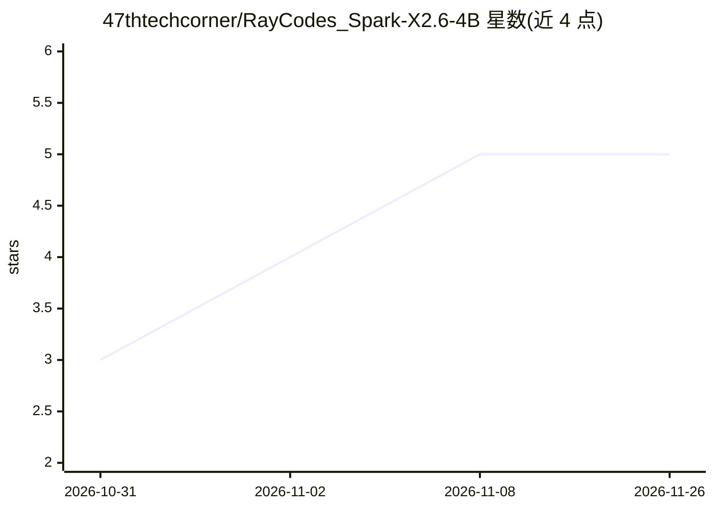

# 47thtechcorner/RayCodes_Spark-X2.6-4B

⭐ 5 · Python · 推送 2026-10-22 · [GitHub](https://github.com/47thtechcorner/RayCodes_Spark-X2.6-4B) · [官网](https://youtu.be/xAdzUb7uBss) · 个人维护

**本地运行的 Python 代码修复 agent，基于 Spark-X2.6-4B 模型**

基于 Spark-X2.6-4B 模型与 Ollama 的开源本地代码修复 agent：读取问题描述与有 bug 的 Python 脚本，生成诊断说明与 unified git diff 补丁，全部在本地运行，不调用云端 API。依赖 Python 3.10+ 与已安装运行的 Ollama，模型通过 ollama 命令拉取，agent 通过 python main.py 运行，从 inputs/research_task.json 读入任务。README 还列出交互终端 UI、多文件扫描、Git Hook 集成等路线图项，均标注为未完成。

## 筛选速览

| 维度 | 判定 | 备注 |
|---|---|---|
| AI 角色 | `ai-native` | 本体是模型或模型工具 |
| 许可风险 | `none` | — |
| 部署形态 | `None` |  |
| 模型依赖 | local-ok | 支持本地模型 |
| 硬件要求 | — | 无带数字的原话,不猜 |
| 安装摩擦 | `low` | 无编译、无系统依赖或容器化 |
| 成熟度 | — | 结构信号不足 |

## 能力要点

- 通过本地 Ollama 实例运行，模型提供 1M token 上下文窗口与可配置思考预算（none/low/high）
- agent 自动生成诊断说明与可直接应用的 unified git diff 补丁
- 任务输入来自 inputs/research_task.json，带 generate_code_fix 工具 schema
- Apache 2.0 许可

## 适用场景

- 把有死循环或内存泄漏的 Python 脚本连同文档喂给 agent 定位并修复
- 把大量 API 文档（最多 1M token）读入本地进行参数与用法查询
- 在本地机器上生成代码补丁而不把私有代码发送到云端

## 场景标签

`编码 Agent` · 领域:编码与开发

## 证据(README 行号)

> L8: An open-source, on-device AI coding assistant powered by Spark-X2.6-4B and Ollama. It combines a 1-million token con
> L34: 2. Connects directly to your local Ollama instance with `generate_code_fix` tool schema.

## 星数曲线

2026-10-31 3 → 2026-11-26 5（+2）

---
*卡片 v1 · prompt 1.4 · 生成 2026-11-21 · 置信度 high · 依据 README sha `f8038e704301` · [字段定义](../../DATASET.md)*
