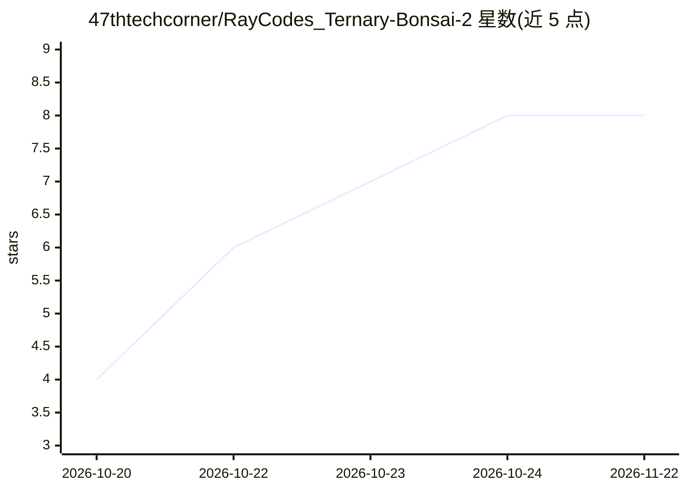

# 47thtechcorner/RayCodes_Ternary-Bonsai-2

⭐ 8 · Python · 推送 2026-10-17 · [GitHub](https://github.com/47thtechcorner/RayCodes_Ternary-Bonsai-2) · [官网](https://youtu.be/KW9PYnYDhjg) · 个人维护

**本地隐私视觉文档扫描与 PII 脱敏工具**

基于 Ternary Bonsai 2（2B 三值量化多模态模型）的本地文档脱敏工具：扫描 inputs/ 目录中的收据、发票、证件图片，检测并遮盖姓名、卡号、终端号、电话号码、医疗处方码等敏感信息，输出脱敏 JSON 报告。完全离线运行、零外部网络请求，RAM 占用 0.43–0.52 GB。通过 Ollama/llama.cpp 本地服务器运行，需从 Hugging Face 下载模型权重，Python 3.10+ 环境，README 以 Windows PowerShell 命令示例安装步骤。

## 筛选速览

| 维度 | 判定 | 备注 |
|---|---|---|
| AI 角色 | `ai-native` | 本体是模型或模型工具 |
| 许可风险 | `none` | — |
| 部署形态 | `library` | 以包/库形式分发 |
| 模型依赖 | local-ok | 支持本地模型 |
| 硬件要求 | `gpu-8g` | |
| 安装摩擦 | `low` | 无编译、无系统依赖或容器化 |
| 成熟度 | — | 结构信号不足 |

## 能力要点

- 0.43–0.52 GB RAM 运行完整多模态推理引擎
- 100% 离线本地处理，零外部网络请求
- 自动遮盖姓名、卡号、终端号、电话、医疗处方码
- 批量扫描 inputs/ 文件夹全部图片并输出审计报告

## 适用场景

- 归档前脱敏诊所登记表中的患者姓名与 SSN
- 报销审核时遮盖收据照片中的银行卡与账户信息
- 无网安全环境中自主分类涉密文档

## 场景标签

`文档解析` · 领域:知识与检索

## 证据(README 行号)

> L12: |Load local receipt, invoice, or ID|Detect PII, cards, and account numbers|Save clean redacted JSON report|
> L20: - **Smart PII Detection:** Automatically masks names, cards, terminals, phone numbers, and medical Rx codes.
> L24: - **Model:** Ternary Bonsai 2 2B (PrismML {-1, 0, +1} quantized multimodal architecture)

## 星数曲线

2026-10-20 4 → 2026-11-22 8（+4）

---
*卡片 v1 · prompt 1.4 · 生成 2026-11-20 · 置信度 high · 依据 README sha `be5f2ff09763` · [字段定义](../../DATASET.md)*
