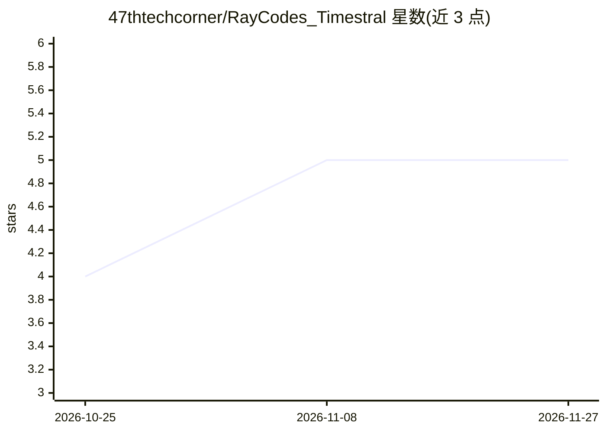

# 47thtechcorner/RayCodes_Timestral

⭐ 5 · Python · 推送 2026-10-19 · [GitHub](https://github.com/47thtechcorner/RayCodes_Timestral) · [官网](https://youtu.be/aaKlUfosjwM) · 个人维护

**基于 Mistral Timestral 在 CPU 本地做零样本时序概率预测的项目合集**

围绕 Mistral AI 官方开源的 Timestral 时序基础模型（5M-209M 参数）的教程型项目：通过 pip 从官方 GitHub 安装 timestral 库及 yfinance/matplotlib/torch，运行 main.py 执行预测管线。读取历史序列与未来日历协变量（最长 32,768 步），在标准 CPU 上以 10-140ms 输出 21 个分位数（P01-P99）的概率预测。附带三个示例项目：股票价格趋势与风险区间、门店销量与缺货规划、现金流安全余额。

## 筛选速览

| 维度 | 判定 | 备注 |
|---|---|---|
| AI 角色 | `ai-native` | 本体是模型或模型工具 |
| 许可风险 | `none` | — |
| 部署形态 | `library` | 以包/库形式分发 |
| 模型依赖 | local-ok | 支持本地模型 |
| 硬件要求 | — | 无带数字的原话,不猜 |
| 安装摩擦 | `low` | 无编译、无系统依赖或容器化 |
| 成熟度 | — | 结构信号不足 |

## 能力要点

- 零样本概率预测：输出 21 个分位数（P01-P99）
- 标准 CPU 推理，无需 GPU（10-140ms）
- 支持最多 32,768 步历史输入与未来协变量条件预测
- 包含 3 个可运行的示例预测管线

## 适用场景

- 用 yfinance 拉取股票历史数据并预测未来 21 个交易日走势
- 结合促销计划预测门店日销量并生成置信区间
- 预测企业周度现金流与最差情景现金缺口

## 场景标签

`教程课程` `金融量化` · 领域:学习与行业

## 证据(README 行号)

> L8: > **Mistral AI's official family of time-series foundation models (5M to 209M parameters) delivering state-of-the-ar
> L21: pip install git+https://github.com/mistralai/timestral.git yfinance matplotlib torch; python main.py

## 星数曲线

2026-10-25 4 → 2026-11-27 5（+1）

---
*卡片 v1 · prompt 1.4 · 生成 2026-11-21 · 置信度 high · 依据 README sha `73875153dee5` · [字段定义](../../DATASET.md)*
