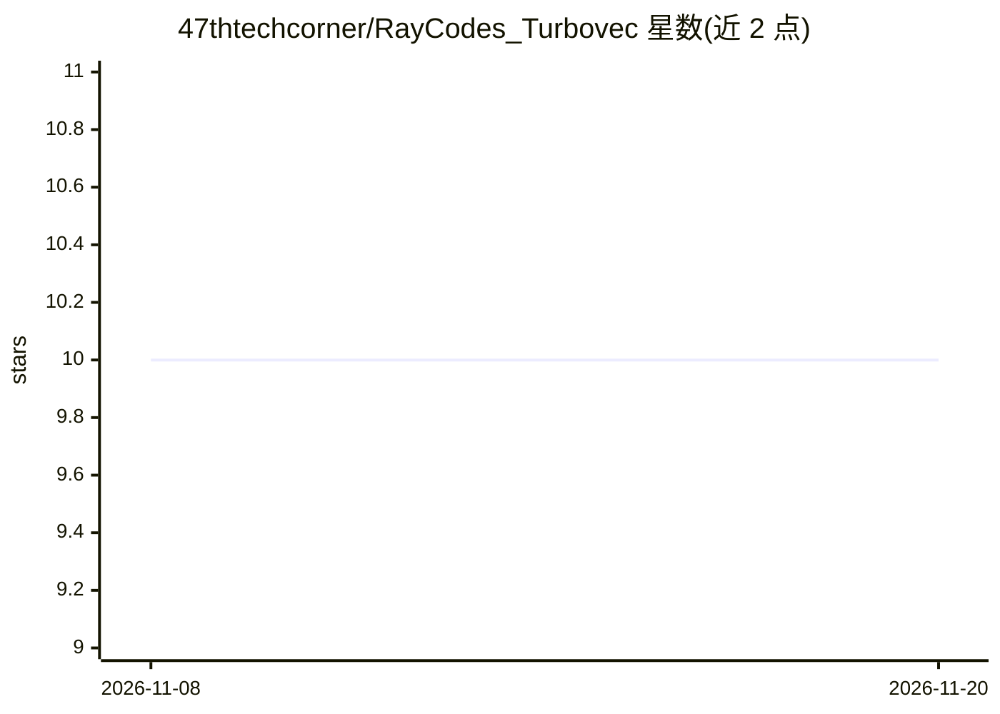

# 47thtechcorner/RayCodes_Turbovec

⭐ 10 · Python · 推送 2026-06-10 · [GitHub](https://github.com/47thtechcorner/RayCodes_Turbovec) · 个人维护

**4GB 内存设备可运行的本地文档 RAG 问答系统**

基于 Streamlit 的本地 RAG 应用（README 中称 PotatoRAG）：将 .txt 文件或粘贴文本分块后用 nomic-embed-text 生成 768 维向量，经 turbovec（基于 Google TurboQuant 算法）量化为 4-bit 表示建索引，声称降低最多 80% 内存占用；查询时以 SIMD 指令检索，由本地 llama3.2:1b 生成流式回答。全程通过 Ollama 本地运行，无需云 API。依赖 Python 3.9+ 与 Ollama，当前仅支持纯文本输入，PDF 等格式解析列入路线图。

## 筛选速览

| 维度 | 判定 | 备注 |
|---|---|---|
| AI 角色 | `ai-native` | 本体是模型或模型工具 |
| 许可风险 | `permissive` | — |
| 部署形态 | `library` | 以包/库形式分发 |
| 模型依赖 | local-ok | 支持本地模型 |
| 硬件要求 | — | 无带数字的原话,不猜 |
| 安装摩擦 | `low` | 无编译、无系统依赖或容器化 |
| 成熟度 | — | 结构信号不足 |

## 能力要点

- turbovec 4-bit 量化索引，面向 4 GB RAM 低内存环境
- 通过 Ollama 本地运行 llama3.2:1b 与 nomic-embed-text，全程离线
- Streamlit Web 界面，流式输出回答
- 生成时通过系统提示词旁路 <think> 标签

## 适用场景

- 在无网络环境中审查敏感法律/财务文档
- 在低配笔记本上对教材和讲义提问总结
- 本地索引代码库文档生成代码

## 场景标签

`RAG` `向量数据库` `模型量化` `文档问答` · 领域:知识与检索

## 证据(README 行号)

> L13: PotatoRAG is a hyper-optimized, privacy-first, local Retrieval-Augmented Generation (RAG) system engineered to run 
> L20: - **Local LLM Engine**: `ollama` (Running `llama3.2:1b` for generation and `nomic-embed-text` for embeddings)
> L63: 2. **Quantized Vector Indexing**: Each chunk is embedded using `nomic-embed-text` to produce a 768-dimensional vect

## 星数曲线

2026-11-08 10 → 2026-11-20 10（+0）

---
*卡片 v1 · prompt 1.4 · 生成 2026-11-20 · 置信度 high · 依据 README sha `f969d7e88897` · [字段定义](../../DATASET.md)*
