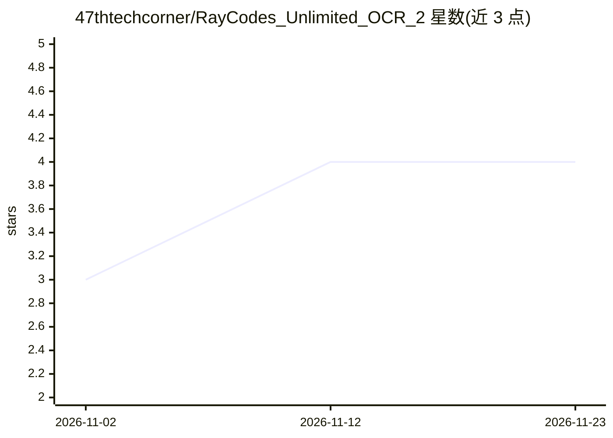

# 47thtechcorner/RayCodes_Unlimited_OCR_2

⭐ 4 · Python · 推送 2026-10-30 · [GitHub](https://github.com/47thtechcorner/RayCodes_Unlimited_OCR_2) · [官网](https://youtu.be/azd2H0Riid4) · 个人维护

**300页长文档单次OCR解析的本地流水线（3.34B MoE模型）**

围绕百度 Unlimited-OCR-2（3.34B MoE，每 token 激活约 500M 参数）构建的本地文档解析流水线：输入长篇 PDF，输出带代码高亮、LaTeX 公式与表格结构的 Markdown。采用 SR-SWA 稀疏参考滑动窗口注意力缓解长文档 KV-Cache 瓶颈，KV Cache 峰值 1.77GB，可在约 2GB 显存的 GPU 上运行。README 提供 Windows PowerShell 环境搭建、权重下载与运行步骤，并列出法律卷宗、科研论文、财报、教材数字化等工作流示例。

## 筛选速览

| 维度 | 判定 | 备注 |
|---|---|---|
| AI 角色 | `ai-native` | 本体是模型或模型工具 |
| 许可风险 | `permissive` | — |
| 部署形态 | `library` | 以包/库形式分发 |
| 模型依赖 | — | README 未给出锁定关系 |
| 硬件要求 | — | 无带数字的原话,不猜 |
| 安装摩擦 | `low` | 无编译、无系统依赖或容器化 |
| 成熟度 | — | 结构信号不足 |

## 能力要点

- SR-SWA 注意力与 MoE 架构，300 页文档单次解析
- KV Cache 峰值 1.77GB，2GB 显存 GPU 可运行
- 输出保留代码块、LaTeX 公式、表格与阅读顺序的 Markdown
- 本地离线运行，权重经 Hugging Face 下载

## 适用场景

- 将数百页教科书或法律卷宗批量转为结构化 Markdown
- 离线解析 arXiv/PubMed 多栏论文并保留公式与表格
- 把财报 PDF 直读为可机读的审计数据结构

## 场景标签

`文档解析` `OCR` `科研工具` · 领域:知识与检索

## 证据(README 行号)

> L14: > "Baidu Unlimited OCR 2 breaks the long-document KV-Cache bottleneck with Sparse Reference Sliding Window Attentio
> L35: ### Step 2: Run Production Pipeline

## 星数曲线

2026-11-02 3 → 2026-11-23 4（+1）

---
*卡片 v1 · prompt 1.4 · 生成 2026-11-21 · 置信度 high · 依据 README sha `5c6cea243a63` · [字段定义](../../DATASET.md)*
