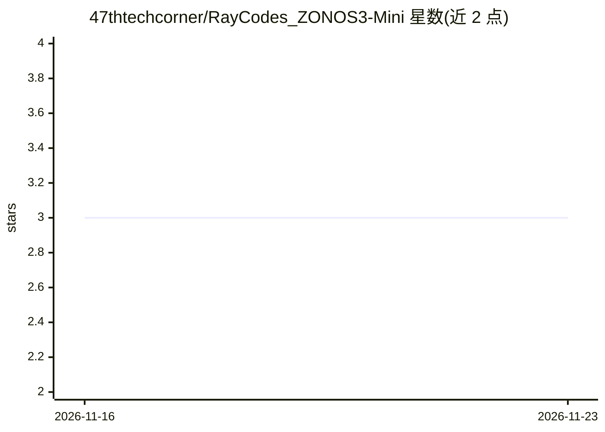

# 47thtechcorner/RayCodes_ZONOS3-Mini

⭐ 3 · Python · 推送 2026-11-14 · [GitHub](https://github.com/47thtechcorner/RayCodes_ZONOS3-Mini) · [官网](https://youtu.be/mVjMSurLBB4) · 个人维护

**本地实时语音克隆与 TTS 管线：100M 激活参数 MoE 模型**

ZONOS3-Mini 是一个基于混合 Gated DeltaNet + Attention MoE 架构的文本转语音与零样本语音克隆管线，模型规模 800M/100M 激活参数，宣称支持 43 种语言、80ms TTFA 延迟、44.1 kHz 音频输出，可在本地笔记本、手机及浏览器（WebGPU）运行。README 提供 Windows PowerShell 的环境搭建与权重下载步骤及 main.py 运行入口，并列出情感控制、跨语种合成、流式输出等测试工作流，未来路线图包含浏览器单文件运行器与移动端量化。

## 筛选速览

| 维度 | 判定 | 备注 |
|---|---|---|
| AI 角色 | `ai-native` | 本体是模型或模型工具 |
| 许可风险 | `permissive` | — |
| 部署形态 | `None` |  |
| 模型依赖 | — | README 未给出锁定关系 |
| 硬件要求 | — | 无带数字的原话,不猜 |
| 安装摩擦 | `low` | 无编译、无系统依赖或容器化 |
| 成熟度 | `idea` | |

## 能力要点

- 零样本语音克隆：10 秒参考音频生成克隆语音
- 80ms TTFA 延迟与 44.1 kHz 音频输出，支持 43 种语言
- 支持 WebGPU 浏览器本地推理，无需云端服务
- 情感与韵律条件控制（emotion/cadence steering）

## 适用场景

- 在浏览器标签页内本地运行语音助手，无云端订阅费用
- 多语种客服场景下保持说话人音色的实时语音应答
- 为游戏 NPC 动态生成带情绪的角色台词
- 从参考音色批量生成有声书章节旁白

## 场景标签

`语音合成` · 领域:内容生成

## 证据(README 行号)

> L6: # ZONOS3-Mini: 100M Active Parameter Real-Time Voice Cloning
> L13: > **"Sub-100ms real-time voice cloning and studio-grade 44.1 kHz text-to-speech powered by a hybrid Gated DeltaNet 
> L19: |Dynamic Emotion-Steered Studio Narrator|High-fidelity zero-shot voice cloning with granular acoustic emotion and c

## 星数曲线

2026-11-16 3 → 2026-11-23 3（+0）

---
*卡片 v1 · prompt 1.4 · 生成 2026-11-22 · 置信度 high · 依据 README sha `9f1b180e0ebb` · [字段定义](../../DATASET.md)*
